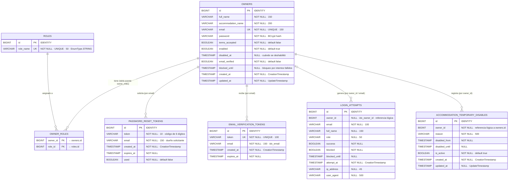

# 🏨 HostFlow Backend

> API REST para la gestión de alojamientos y sus propietarios: registro con verificación de correo, autenticación JWT, recuperación de contraseña, control de roles y desactivación temporal de alojamientos.


---

## 📑 Tabla de contenidos

1. [Descripción general](#-descripción-general)
2. [Características](#-características)
3. [Stack tecnológico](#-stack-tecnológico)
4. [Arquitectura del proyecto](#-arquitectura-del-proyecto)
5. [Requisitos previos](#-requisitos-previos)
6. [Instalación y ejecución](#-instalación-y-ejecución)
7. [Variables de entorno](#-variables-de-entorno)
8. [Configuración de la aplicación](#-configuración-de-la-aplicación)
9. [Documentación de la API](#-documentación-de-la-api)
10. [Modelo Entidad-Relación (MER)](#-modelo-entidad-relación-mer)
11. [Seguridad](#-seguridad)
12. [Manejo de errores](#-manejo-de-errores)
13. [Flujo de trabajo con Git](#-flujo-de-trabajo-con-git)
14. [Consideraciones para producción](#-consideraciones-para-producción)
15. [Equipo y licencia](#-equipo-y-licencia)

---

## 📖 Descripción general

**HostFlow** es el backend de una plataforma orientada a propietarios de alojamientos (*owners*) y administradores. Expone una API REST bajo el prefijo `/api/v1` que permite:

- Registrar propietarios y verificar su correo electrónico.
- Autenticar usuarios mediante **JSON Web Tokens (JWT)**.
- Recuperar contraseñas con un código de 6 dígitos enviado por correo.
- Administrar usuarios (consulta y habilitación/deshabilitación) desde un rol administrador.
- Desactivar temporalmente un alojamiento (remodelación, mantenimiento, etc.) y consultar su estado, historial y disponibilidad.

---

## ✨ Características

| Área | Detalle |
|------|---------|
| **Autenticación** | Login con JWT (access token de 24 h y refresh token de 7 días configurables). |
| **Autorización** | Control por roles `ROLE_ADMIN` y `ROLE_OWNER` con `@PreAuthorize`. |
| **Verificación de correo** | Enlace con token de expiración (60 min por defecto) y reenvío de verificación. |
| **Recuperación de contraseña** | Código numérico de 6 dígitos con expiración (60 min por defecto). |
| **Protección contra fuerza bruta** | Bloqueo de cuenta tras 5 intentos fallidos durante 60 minutos, con registro de intentos (IP y *user agent*). |
| **Cierre por inactividad** | Tiempos de inactividad por rol (Owner: 10 min, Admin: 15 min) y aviso previo de 1 min, entregados al frontend. |
| **Desactivación de alojamientos** | Desactivación temporal con motivo y rango de fechas, historial y consulta de disponibilidad. |
| **Datos semilla** | Creación automática de roles y de un super usuario administrador en el primer arranque. |
| **Documentación interactiva** | Swagger UI / OpenAPI 3 con soporte para autenticación Bearer. |
| **Serialización limpia** | Fechas ISO-8601 y exclusión de campos `null` en las respuestas JSON. |

---

## 🧰 Stack tecnológico

- **Lenguaje:** Java (17 o superior, requerido por Spring Boot 3)
- **Framework:** Spring Boot (Web, Data JPA, Security, Validation, Mail)
- **Persistencia:** Hibernate / JPA sobre **PostgreSQL**
- **Seguridad:** Spring Security + JWT + BCrypt
- **Documentación:** springdoc-openapi (Swagger UI)
- **Utilidades:** Lombok, SLF4J
- **Migraciones:** Flyway (deshabilitado en desarrollo; previsto para producción)
- **Correo:** SMTP (Gmail)
- **Build:** Maven

---

## 🗂 Arquitectura del proyecto

El proyecto sigue una **arquitectura en capas** bajo el paquete base `com.hostflow`:

```text
com.hostflow
├── HostflowApplication.java        # Punto de entrada de Spring Boot
├── config/                         # Configuración transversal
│   ├── DataInitializer.java        #   Seed de roles y administrador
│   ├── EmailConfig.java            #   Parámetros de correo
│   ├── InactivityConfig.java       #   Tiempos de inactividad por rol
│   ├── SwaggerConfig.java          #   OpenAPI / Bearer Authentication
│   └── WebConfig.java              #   Configuración MVC
├── controller/                     # Capa REST
│   ├── AuthController.java         #   /auth
│   ├── OwnerController.java        #   /owners
│   └── AccommodationController.java#   /owners/accommodation
├── dto/
│   ├── request/                    # Objetos de entrada validados
│   └── response/                   # Objetos de salida
├── enums/
│   └── RoleType.java               # ROLE_ADMIN, ROLE_OWNER
├── exception/                      # Excepciones de negocio y handler global
├── model/                          # Entidades JPA
├── repository/                     # Repositorios Spring Data JPA
├── security/                       # JWT, filtro, SecurityConfig, UserDetailsService
└── service/                        # Lógica de negocio
    ├── AuthService.java
    ├── OwnerService.java
    ├── PasswordResetService.java
    ├── LoginAttemptService.java
    ├── JwtService.java
    ├── EmailService.java
    └── AccommodationTemporaryDisableService.java
```

---

## ✅ Requisitos previos

- **JDK 17+**
- **Maven 3.8+** (o el *wrapper* del proyecto, si existe)
- **PostgreSQL** en ejecución local
- Una cuenta de **Gmail** con *Contraseña de aplicación* para el envío de correos
- IDE recomendado: IntelliJ IDEA

---

## 🚀 Instalación y ejecución

### 1. Clonar el repositorio

```bash
git clone <URL-DEL-REPOSITORIO>
cd hostflow
```

### 2. Crear la base de datos

```sql
CREATE DATABASE hostflow_dev;
```

> Con `ddl-auto=update`, Hibernate crea las tablas automáticamente en el primer arranque.

### 3. Configurar las variables de entorno

Define las variables descritas en [Variables de entorno](#-variables-de-entorno). En IntelliJ IDEA: **Run → Edit Configurations → Environment variables**.

### 4. Ejecutar la aplicación

```bash
mvn spring-boot:run -Dspring-boot.run.profiles=dev
```

Para generar el artefacto y ejecutarlo:

```bash
mvn clean package
java -jar target/hostflow-*.jar --spring.profiles.active=dev
```

### 5. Verificar

- API base: `http://localhost:8080/api/v1`
- Swagger UI: `http://localhost:8080/api/v1/swagger-ui.html`

---

## 🔐 Variables de entorno

| Variable | Obligatoria | Valor por defecto | Descripción |
|----------|:-----------:|-------------------|-------------|
| `JWT_SECRET` | ✅ | — | Clave secreta para firmar los JWT. Mínimo 32 caracteres. |
| `ADMIN_PASSWORD` | ✅ | — | Contraseña del super usuario administrador. |
| `DB_USERNAME` | ➖ | `postgres` | Usuario de PostgreSQL. |
| `DB_PASSWORD` | ➖ | `postgres` | Contraseña de PostgreSQL. |
| `MAIL_USERNAME` | ✅ | — | Cuenta de Gmail emisora de los correos. |
| `MAIL_PASSWORD` | ✅ | — | *App Password* de 16 caracteres (sin espacios). |

> ⚠️ **Nunca** subas credenciales reales al repositorio. Usa variables de entorno o un archivo `.env` local ignorado por Git.

Para generar la contraseña de aplicación de Gmail, activa la verificación en dos pasos y crea una en <https://myaccount.google.com/apppasswords>.

---

## ⚙️ Configuración de la aplicación

Propiedades principales (`application.properties`):

| Propiedad | Valor | Descripción |
|-----------|-------|-------------|
| `server.port` | `8080` | Puerto del servidor. |
| `server.servlet.context-path` | `/api/v1` | Prefijo de todos los endpoints. |
| `jwt.expiration` | `86400000` | Vida del access token (24 h). |
| `jwt.refresh-expiration` | `604800000` | Vida del refresh token (7 días). |
| `jwt.issuer` | `HostFlow` | Claim `iss` del token. |
| `app.password-reset.expiration-minutes` | `60` | Validez del código de recuperación. |
| `app.password-reset.code-length` | `6` | Longitud del código. |
| `app.inactivity.owner-milliseconds` | `600000` | Inactividad máxima Owner (10 min). |
| `app.inactivity.admin-milliseconds` | `900000` | Inactividad máxima Admin (15 min). |
| `app.inactivity.warning-before-milliseconds` | `60000` | Aviso previo al cierre (1 min). |
| `app.security.max-failed-attempts` | `5` | Intentos fallidos antes del bloqueo. |
| `app.security.block-duration-minutes` | `60` | Duración del bloqueo. |
| `app.security.failed-attempts-window-minutes` | `60` | Ventana para contar intentos fallidos. |

### Perfiles

| Perfil | Uso | Notas |
|--------|-----|-------|
| `dev` | Desarrollo local | PostgreSQL local, `ddl-auto=update`, `show-sql=true`, Flyway desactivado. |
| `prod` | Producción | `ddl-auto=validate`, Flyway activo, variables de entorno obligatorias. |

---

## 📡 Documentación de la API

**URL base:** `http://localhost:8080/api/v1`

La documentación interactiva está disponible en:

- **Swagger UI:** `/swagger-ui.html`
- **OpenAPI JSON:** `/api-docs`

Para consumir endpoints protegidos, envía el token en la cabecera:

```http
Authorization: Bearer <JWT>
```

### 🔑 Autenticación — `/auth` (público)

| Método | Endpoint | Descripción |
|--------|----------|-------------|
| `POST` | `/auth/register` | Registra un propietario y envía el correo de verificación. |
| `POST` | `/auth/login` | Inicia sesión y devuelve el JWT. |
| `POST` | `/auth/forgot-password` | Envía un código de recuperación al correo. |
| `POST` | `/auth/reset-password` | Restablece la contraseña con el código recibido. |
| `GET`  | `/auth/verify-email?token=` | Verifica el correo con el token del enlace. |
| `POST` | `/auth/resend-verification?email=` | Reenvía el correo de verificación. |

**Ejemplo — registro**

```http
POST /api/v1/auth/register
Content-Type: application/json

{
  "fullName": "María Pérez",
  "accommodationName": "Casa Rural El Roble",
  "email": "maria@example.com",
  "password": "MiClaveSegura123",
  "termsAccepted": true
}
```

**Ejemplo — login**

```http
POST /api/v1/auth/login
Content-Type: application/json

{
  "email": "maria@example.com",
  "password": "MiClaveSegura123"
}
```

**Respuesta (campos principales)**

```json
{
  "token": "eyJhbGciOiJIUzI1NiJ9...",
  "tokenType": "Bearer",
  "userId": 1,
  "email": "maria@example.com",
  "fullName": "María Pérez",
  "roles": ["ROLE_OWNER"],
  "emailVerified": true,
  "inactivityTimeoutMs": 600000,
  "warningBeforeMs": 60000
}
```

**Ejemplo — restablecer contraseña**

```http
POST /api/v1/auth/reset-password
Content-Type: application/json

{
  "email": "maria@example.com",
  "code": "123456",
  "newPassword": "NuevaClave456"
}
```

> Los nombres exactos de los campos de los DTO pueden consultarse en Swagger UI.

### 👤 Propietarios — `/owners` (requiere JWT)

| Método | Endpoint | Rol requerido | Descripción |
|--------|----------|---------------|-------------|
| `GET`   | `/owners` | `ADMIN` | Lista todos los propietarios. |
| `GET`   | `/owners/{id}` | `OWNER`, `ADMIN` | Obtiene un propietario por ID. |
| `GET`   | `/owners/email/{email}` | `OWNER`, `ADMIN` | Obtiene un propietario por correo. |
| `PATCH` | `/owners/{id}/status?enabled=` | `ADMIN` | Habilita o deshabilita una cuenta. |

### 🏠 Alojamiento — `/owners/accommodation` (requiere JWT, rol `OWNER`)

| Método | Endpoint | Descripción |
|--------|----------|-------------|
| `POST` | `/owners/accommodation/disable` | Desactiva temporalmente el alojamiento (motivo y fechas obligatorios). |
| `POST` | `/owners/accommodation/enable` | Reactiva el alojamiento. |
| `GET`  | `/owners/accommodation/status` | Consulta el estado actual. |
| `GET`  | `/owners/accommodation/history` | Historial de desactivaciones. |
| `GET`  | `/owners/accommodation/availability?date=` | Verifica disponibilidad en una fecha/hora (`LocalDateTime` ISO-8601). |

### Reglas de validación

| Campo | Regla |
|-------|-------|
| `fullName` | Obligatorio, 3–150 caracteres. |
| `accommodationName` | Obligatorio, 3–200 caracteres. |
| `email` | Obligatorio, formato válido. |
| `password` | Obligatorio, 8–100 caracteres. |
| `termsAccepted` | Obligatorio (aceptación de términos y privacidad). |
| `code` (recuperación) | Obligatorio, exactamente 6 caracteres. |
| `reason` / `disabledFrom` (desactivación) | Obligatorios. |

---

## 🗄 Modelo Entidad-Relación (MER)

El esquema se genera automáticamente con Hibernate (`ddl-auto=update` en desarrollo) a partir de las entidades JPA del paquete `com.hostflow.model`.



### Descripción de las tablas

| Tabla | Propósito |
|-------|-----------|
| `owners` | Usuario/propietario: datos personales, credenciales, estado (`enabled`, `email_verified`, `blocked_until`) y fechas de auditoría. |
| `roles` | Catálogo de roles del sistema (`ROLE_ADMIN`, `ROLE_OWNER`). |
| `owner_roles` | Tabla puente de la relación *many-to-many* entre `owners` y `roles`. |
| `password_reset_tokens` | Códigos de recuperación de contraseña con expiración y marca de uso. |
| `email_verification_tokens` | Tokens únicos de verificación de correo con expiración. |
| `login_attempts` | Auditoría de intentos de inicio de sesión (éxito, bloqueo, IP y *user agent*). |
| `accommodation_temporary_disables` | Periodos de desactivación temporal de un alojamiento, con motivo y rango de fechas. |

### Índices

| Tabla | Índice | Columnas |
|-------|--------|----------|
| `email_verification_tokens` | `idx_token_unique` (único) | `token` |
| `email_verification_tokens` | `idx_email` | `email` |
| `login_attempts` | `idx_email_attempt` | `email`, `attempt_at` |
| `login_attempts` | `idx_owner_id` | `owner_id` |
| `accommodation_temporary_disables` | `idx_owner_active` | `owner_id`, `is_active` |
| `accommodation_temporary_disables` | `idx_disable_dates` | `disabled_from`, `disabled_until` |
| `accommodation_temporary_disables` | `idx_owner_created` | `owner_id`, `created_at` |

> **Nota:** `password_reset_tokens`, `email_verification_tokens`, `login_attempts` y `accommodation_temporary_disables` se relacionan con `owners` mediante `email` u `owner_id` como **referencia lógica**, sin clave foránea declarada en la base de datos. Las únicas claves foráneas explícitas son las de `owner_roles`.

---

## 🛡 Seguridad

- **Autenticación *stateless*** con JWT; filtro `JwtAuthenticationFilter` antes de `UsernamePasswordAuthenticationFilter`.
- **Contraseñas** cifradas con **BCrypt**.
- **CSRF deshabilitado** (API sin sesión) y **CORS** configurado para los orígenes:
  `http://localhost:3000`, `http://localhost:4200` y `http://localhost:8080`.
- **Rutas públicas:** `/auth/**`, Swagger/OpenAPI, `/static/**` y `/public/**`. Cualquier otra requiere autenticación.
- **Bloqueo de cuenta** tras intentos fallidos consecutivos.
- **Verificación de correo obligatoria** antes de poder iniciar sesión.

---

## 🚨 Manejo de errores

Las excepciones se centralizan en `GlobalExceptionHandler`:

| Excepción | Uso |
|-----------|-----|
| `BusinessException` | Violaciones de reglas de negocio. |
| `ResourceNotFoundException` | Recurso inexistente. |
| Errores de validación | Mensajes definidos en los DTO (`@Valid`). |

---

## 🌿 Flujo de trabajo con Git

Se recomienda trabajar con ramas por funcionalidad:

```bash
git checkout -b feature/nombre-de-la-funcionalidad
git add .
git commit -m "feat: descripción breve del cambio"
git push origin feature/nombre-de-la-funcionalidad
```

Convención de commits sugerida: `feat`, `fix`, `docs`, `refactor`, `test`, `chore`. Los cambios se integran mediante *Pull Request* con revisión de al menos un compañero.

---

## 🏭 Consideraciones para producción

Antes de desplegar, revisa esta lista:

- [ ] Cambiar `spring.jpa.hibernate.ddl-auto` a **`validate`** y activar **Flyway**.
- [ ] Deshabilitar `DataInitializer` fuera de desarrollo (por ejemplo con `@Profile("dev")`).
- [ ] **Eliminar la contraseña del administrador escrita en el código** del inicializador y usar `ADMIN_PASSWORD` (propiedad `app.admin.password`).
- [ ] Definir `JWT_SECRET` robusto (32+ caracteres) mediante variable de entorno.
- [ ] Ajustar los orígenes **CORS** al dominio real del frontend.
- [ ] Reducir los niveles de log (`DEBUG` → `INFO`) y desactivar `show-sql`.
- [ ] Usar una cuenta de correo transaccional dedicada y no personal.
- [ ] Restringir o proteger el acceso a Swagger UI.

---

## 👥 Equipo y licencia

Desarrollado por el **HostFlow Team**.

Licencia: _por definir_ (agrega un archivo `LICENSE` en la raíz del repositorio).
