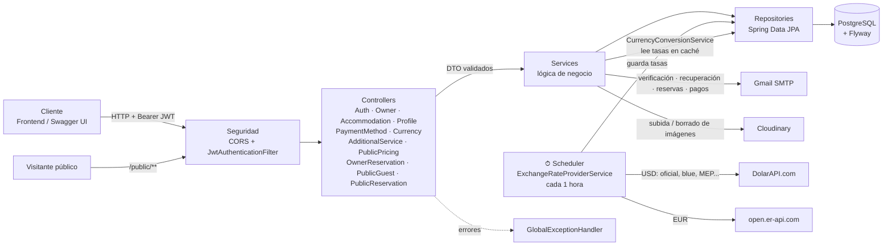
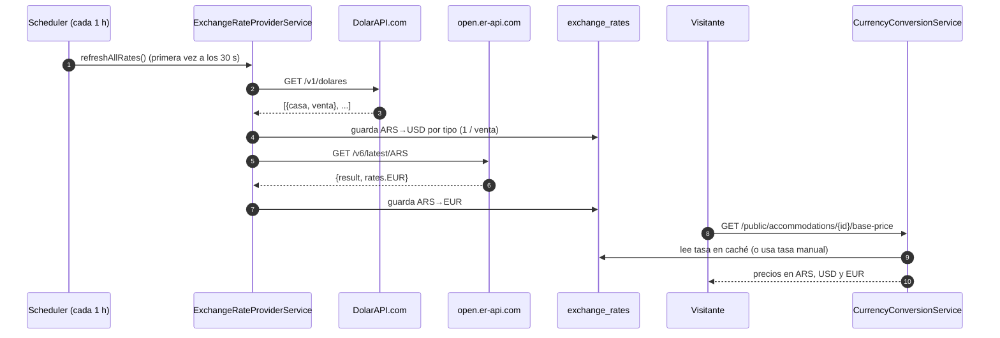
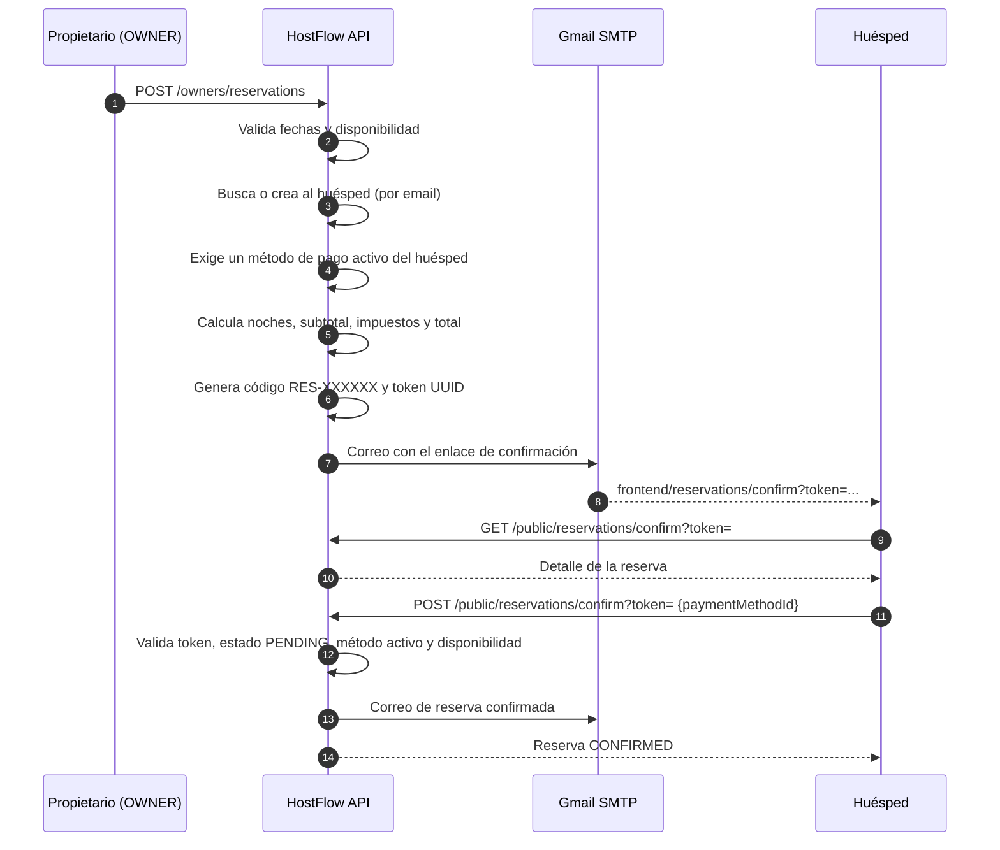
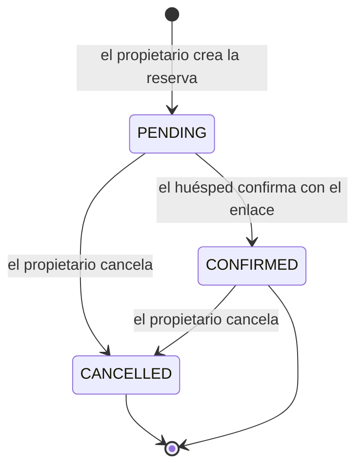
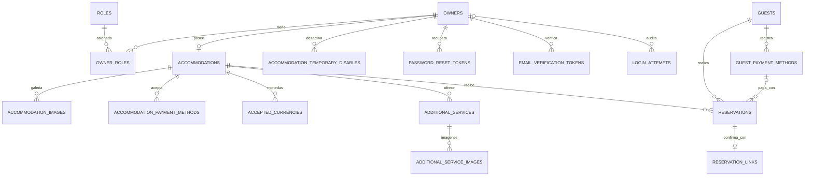

# 🏨 HostFlow Backend

> API REST para la gestión de alojamientos y sus propietarios: registro con verificación de correo, autenticación JWT, perfil y galería (imágenes en Cloudinary), métodos de pago, **servicios adicionales**, **precios multimoneda (ARS / USD / EUR) con cotizaciones automáticas** y consulta pública de precios, **reservas con enlace de confirmación por correo** y gestión de **huéspedes**.


---

## 📑 Tabla de contenidos

1. [Descripción general](#-descripción-general)
2. [Características](#-características)
3. [Stack tecnológico](#-stack-tecnológico)
4. [Arquitectura del proyecto](#-arquitectura-del-proyecto)
5. [Requisitos previos](#-requisitos-previos)
6. [Instalación y ejecución](#-instalación-y-ejecución)
7. [Variables de entorno](#-variables-de-entorno)
8. [Configuración de Cloudinary](#-configuración-de-cloudinary)
9. [Conversión de monedas y APIs de cotización](#-conversión-de-monedas-y-apis-de-cotización)
10. [Reservas y huéspedes](#-reservas-y-huéspedes)
11. [Configuración de la aplicación](#-configuración-de-la-aplicación)
12. [Documentación de la API](#-documentación-de-la-api)
13. [Modelo Entidad-Relación (MER)](#-modelo-entidad-relación-mer)
14. [Seguridad](#-seguridad)
15. [Manejo de errores](#-manejo-de-errores)
16. [Flujo de trabajo con Git](#-flujo-de-trabajo-con-git)
17. [Consideraciones para producción](#-consideraciones-para-producción)
18. [Equipo y licencia](#-equipo-y-licencia)

---

## 📖 Descripción general

**HostFlow** es el backend de una plataforma para propietarios de alojamientos (*owners*) y administradores. Expone una API REST bajo el prefijo `/api/v1` que permite:

- Registrar propietarios y verificar su correo electrónico.
- Autenticar usuarios mediante **JSON Web Tokens (JWT)** y recuperar contraseñas con un código de 6 dígitos.
- Administrar usuarios (consulta y habilitación/deshabilitación) desde un rol administrador.
- Registrar el **perfil del alojamiento** y su **galería de imágenes** en **Cloudinary**.
- Gestionar **métodos de pago** y **servicios adicionales** (con hasta 3 imágenes cada uno).
- Habilitar **monedas (ARS, USD, EUR)** con tasa **automática** (APIs externas) o **manual**.
- Exponer **precios públicos** del alojamiento y de sus servicios convertidos a todas las monedas habilitadas.
- Crear **reservas** con control de disponibilidad, cálculo de noches e impuestos y un **enlace de confirmación** enviado por correo al huésped.
- Registrar **huéspedes** y sus **métodos de pago** mediante endpoints públicos.
- Enviar **notificaciones por correo** (solicitud, confirmación y cancelación de reservas; alta de método de pago del propietario).
- Desactivar temporalmente un alojamiento y consultar su estado, historial y disponibilidad.

---

## ✨ Características

| Área | Detalle |
|------|---------|
| **Autenticación** | Login con JWT (access token de 24 h y refresh token de 7 días configurables). |
| **Autorización** | Roles `ROLE_ADMIN` y `ROLE_OWNER` con `@PreAuthorize`. |
| **Verificación de correo** | Enlace con token de expiración (60 min) y reenvío de verificación. |
| **Recuperación de contraseña** | Código numérico de 6 dígitos con expiración (60 min). |
| **Protección contra fuerza bruta** | Bloqueo tras 5 intentos fallidos durante 60 minutos, con registro de IP y *user agent*. |
| **Cierre por inactividad** | Owner: 10 min, Admin: 15 min, con aviso previo de 1 min. |
| **Perfil y galería** | Un alojamiento por propietario; logotipo y galería en Cloudinary (máx. 5 MB). |
| **Métodos de pago** | CRUD con método predeterminado automático. |
| **Servicios adicionales** | CRUD con precio base, tipo de cobro (por día / total), activación y hasta 3 imágenes. |
| **Multimoneda** | ARS, USD y EUR; tasa automática o manual; 7 tipos de cotización del dólar. |
| **Cotizaciones automáticas** | Tarea programada cada hora con **DolarAPI.com** (USD) y **open.er-api.com** (EUR), con caché en base de datos. |
| **Precios públicos** | Endpoints sin autenticación con precios convertidos. |
| **Reservas** | Estados `PENDING → CONFIRMED / CANCELLED`, validación de fechas (1–365 noches), detección de solapamientos y código `RES-XXXXXX`. |
| **Confirmación por enlace** | Token UUID con vigencia configurable (24 h por defecto, 1–168 h), de un solo uso y reactivable por el propietario. |
| **Huéspedes** | Alta o búsqueda por correo (único) y documento (único), con sus propios métodos de pago. |
| **Notificaciones** | Correos transaccionales de reservas y de alta de métodos de pago. |
| **Desactivación temporal** | Motivo, rango de fechas, historial y consulta de disponibilidad. |
| **Migraciones** | Esquema versionado con **Flyway** (`db/migration`). |
| **Documentación interactiva** | Swagger UI / OpenAPI 3 con autenticación Bearer (solo en desarrollo). |

---

## 🧰 Stack tecnológico

| Componente | Versión / detalle |
|------------|-------------------|
| Lenguaje | **Java 17** |
| Framework | **Spring Boot 3.2.5** (Web, Data JPA, Security, Validation, Mail) |
| Base de datos | **PostgreSQL** (Hibernate / JPA, HikariCP) |
| Migraciones | **Flyway** Core (9.x) |
| Seguridad | Spring Security + **JJWT 0.12.5** + BCrypt |
| Imágenes | **Cloudinary** (`cloudinary-http5` 2.4.0) |
| Cotizaciones | **DolarAPI.com** + **open.er-api.com** vía `RestTemplate` |
| Tareas programadas | `@EnableScheduling` / `@Scheduled` |
| Documentación | springdoc-openapi **2.5.0** (Swagger UI) |
| Correo | SMTP Gmail (`spring-boot-starter-mail`) |
| Utilidades | Lombok, DevTools |
| Pruebas | Spring Boot Test, Spring Security Test, H2 |
| Build | Maven |

---

## 🗂 Arquitectura del proyecto

### Flujo de una petición



### Estructura de paquetes

El proyecto sigue una **arquitectura en capas** bajo el paquete base `com.hostflow`:

```text
com.hostflow
├── HostflowApplication.java          # @SpringBootApplication + @EnableScheduling
├── config/
│   ├── CloudinaryConfig.java         # Bean Cloudinary (conexión segura)
│   ├── CloudinaryProperties.java     # Propiedades cloudinary.* validadas
│   ├── DataInitializer.java          # Seed de roles y administrador
│   ├── EmailConfig.java
│   ├── InactivityConfig.java         # Tiempos de inactividad por rol
│   ├── RestTemplateConfig.java       # RestTemplate (timeouts 5 s / 10 s) para APIs externas
│   ├── SecurityConfig.java           # Reglas de acceso y CORS
│   ├── SwaggerConfig.java            # OpenAPI + Bearer Authentication
│   └── WebConfig.java
├── controller/
│   ├── AuthController.java                       # /auth
│   ├── OwnerController.java                      # /owners
│   ├── AccommodationController.java              # /owners/accommodation (desactivación)
│   ├── AccommodationProfileController.java       # perfil, logo y galería
│   ├── AccommodationPaymentMethodController.java # /owners/accommodation/payment-methods
│   ├── AccommodationCurrencyController.java      # /owners/accommodation/currencies
│   ├── AdditionalServiceController.java          # /owners/accommodation/additional-services
│   ├── OwnerReservationController.java           # /owners/reservations (OWNER)
│   ├── PublicGuestController.java                # /public/guests
│   ├── PublicPricingController.java              # /public/accommodations/{id}/...
│   └── PublicReservationController.java          # /public/reservations/confirm
├── dto/
│   ├── request/    # AcceptedCurrency, AccommodationDisable, AccommodationImage,
│   │               # AccommodationPaymentMethod, AccommodationProfile, AdditionalService,
│   │               # ConfirmReservation, CreateGuest, CreateReservation, ForgotPassword,
│   │               # GuestPaymentMethod, Login, OwnerRegister, ResetPassword
│   └── response/   # AcceptedCurrency, AccommodationDisable, AccommodationImage,
│                   # AccommodationPaymentMethod, AccommodationProfile, AdditionalService,
│                   # AdditionalServiceImage, Auth, CloudinaryUploadResult,
│                   # ConvertedPrice, Guest, GuestPaymentMethod, Owner, PasswordReset,
│                   # Reservation, ReservationLink
├── enums/
│   ├── Currency.java                 # ARS, USD, EUR (símbolo y escala 2)
│   ├── PaymentMethodType.java        # BANK_TRANSFER, DIGITAL_WALLET, CASH, CARD, OTHER
│   ├── ReservationStatus.java        # PENDING, CONFIRMED, CANCELLED, EXPIRED, COMPLETED
│   ├── RoleType.java                 # ROLE_ADMIN, ROLE_OWNER
│   ├── ServicePriceType.java         # PER_DAY, TOTAL
│   └── UsdRateType.java              # OFICIAL, BLUE, BOLSA, CONTADOCONLIQUI, MAYORISTA, CRIPTO, TARJETA
├── exception/
│   ├── BusinessException.java
│   ├── CloudinaryDeleteException.java
│   ├── CloudinaryUploadException.java
│   ├── GlobalExceptionHandler.java
│   ├── InvalidImageException.java    # extiende BusinessException
│   └── ResourceNotFoundException.java
├── model/
│   ├── AcceptedCurrency.java
│   ├── Accommodation.java
│   ├── AccommodationImage.java
│   ├── AccommodationPaymentMethod.java
│   ├── AccommodationTemporaryDisable.java
│   ├── AdditionalService.java
│   ├── AdditionalServiceImage.java
│   ├── EmailVerificationToken.java
│   ├── ExchangeRateCache.java        # tabla exchange_rates
│   ├── Guest.java                    # huésped
│   ├── GuestPaymentMethod.java       # métodos de pago del huésped
│   ├── LoginAttempt.java
│   ├── Owner.java
│   ├── PasswordResetToken.java
│   ├── Reservation.java
│   ├── ReservationLink.java          # enlace/token de confirmación (1:1)
│   └── Role.java
├── repository/     # Un repositorio Spring Data JPA por entidad (17)
├── security/
│   ├── CustomUserDetailsService.java
│   ├── JwtAuthenticationFilter.java
│   └── PasswordEncoderConfig.java
└── service/
    ├── AcceptedCurrencyService.java
    ├── AccommodationPaymentMethodService.java
    ├── AccommodationProfileService.java
    ├── AccommodationTemporaryDisableService.java
    ├── AdditionalServiceImageService.java
    ├── AdditionalServiceService.java
    ├── AuthService.java
    ├── CloudinaryImageService.java
    ├── CurrencyConversionService.java     # Resuelve tasa efectiva y convierte montos
    ├── EmailService.java                  # + correos de reservas y de método de pago
    ├── ExchangeRateProviderService.java   # Consume APIs externas (tarea programada)
    ├── GuestService.java                  # Huéspedes y sus métodos de pago
    ├── JwtService.java
    ├── LoginAttemptService.java
    ├── OwnerService.java
    ├── PasswordResetService.java
    └── ReservationService.java            # Reservas, enlaces de confirmación y disponibilidad
```

---

## ✅ Requisitos previos

- **JDK 17**
- **Maven 3.8+**
- **PostgreSQL** en ejecución local
- Cuenta de **Gmail** con *Contraseña de aplicación* (envío de correos)
- Cuenta gratuita de **Cloudinary** (almacenamiento de imágenes)
- **Acceso a Internet** saliente hacia `dolarapi.com` y `open.er-api.com` (cotizaciones; no requieren API Key)
- IDE recomendado: IntelliJ IDEA

---

## 🚀 Instalación y ejecución

### 1. Clonar el repositorio

```bash
git clone <URL-DEL-REPOSITORIO>
cd hostflow
```

### 2. Crear la base de datos

```sql
CREATE DATABASE hostflow_dev;
```

> ⚠️ En los perfiles `dev` y `prod`, `spring.jpa.hibernate.ddl-auto=validate` y **Flyway está activo**: Hibernate **no crea** las tablas. El esquema debe provenir de las migraciones SQL en `src/main/resources/db/migration/` (Flyway usa `baseline-on-migrate=true` y `baseline-version=5`). Si las tablas no existen, la aplicación no arrancará.

### 3. Crear el archivo `.env`

Copia la plantilla de variables de entorno como `.env` (en la raíz o en `backend/`) y reemplaza los valores de ejemplo (ver [Variables de entorno](#-variables-de-entorno)). Spring Boot lo importa automáticamente y **no debe subirse al repositorio**.

### 4. Ejecutar la aplicación

```bash
mvn spring-boot:run -Dspring-boot.run.profiles=dev
```

O generando el artefacto:

```bash
mvn clean package
java -jar target/hostflow-backend-1.0.0.jar --spring.profiles.active=dev
```

### 5. Verificar

- API base: `http://localhost:8080/api/v1`
- Swagger UI: `http://localhost:8080/api/v1/swagger-ui.html`
- OpenAPI JSON: `http://localhost:8080/api/v1/api-docs`

A los 30 segundos del arranque se ejecuta la primera actualización de cotizaciones (revisa el log `🔄 Iniciando actualización de tasas de cambio...`).

---

## 🔐 Variables de entorno

| Variable | Obligatoria | Valor por defecto | Descripción |
|----------|:-----------:|-------------------|-------------|
| `DB_URL` | ➖ | `jdbc:postgresql://localhost:5432/hostflow_dev` (prod: `hostflow_prod`) | URL JDBC. |
| `DB_USERNAME` | ➖ | `postgres` (prod: `hostflow_user`) | Usuario de PostgreSQL. |
| `DB_PASSWORD` | ✅ | `postgres` (prod: `change_me_in_production`) | Contraseña de PostgreSQL. |
| `JWT_SECRET` | ✅ | — | Clave para firmar los JWT. **Mínimo 64 caracteres** (HS512). Generar con `openssl rand -hex 48`. |
| `ADMIN_PASSWORD` | ✅ | `adminPassword` | Contraseña inicial del administrador. |
| `MAIL_USERNAME` | ✅ | — | Cuenta de Gmail emisora. |
| `MAIL_PASSWORD` | ✅ | — | *App Password* de 16 caracteres (sin espacios). |
| `CLOUDINARY_CLOUD_NAME` | ✅ | — | Nombre de la nube de Cloudinary. |
| `CLOUDINARY_API_KEY` | ✅ | — | API Key de Cloudinary. |
| `CLOUDINARY_API_SECRET` | ✅ | — | API Secret de Cloudinary. |
| `CLOUDINARY_FOLDER` | ➖ | `hostflow` | Carpeta base de las imágenes. |

Las APIs de cotización (DolarAPI.com y open.er-api.com) **no requieren credenciales**.

Ejemplo de `.env`:

```properties
DB_USERNAME=postgres
DB_PASSWORD=tu_clave_local
JWT_SECRET=<cadena-aleatoria-de-64+-caracteres>
ADMIN_PASSWORD=<clave-del-administrador>
MAIL_USERNAME=tu_cuenta@gmail.com
MAIL_PASSWORD=abcdefghijklmnop
CLOUDINARY_CLOUD_NAME=tu_cloud_name
CLOUDINARY_API_KEY=tu_api_key
CLOUDINARY_API_SECRET=tu_api_secret
CLOUDINARY_FOLDER=hostflow
```

> ⚠️ **Nunca** subas credenciales reales. Verifica que `.env` esté en `.gitignore`.

---

## ☁️ Configuración de Cloudinary

HostFlow usa [Cloudinary](https://cloudinary.com/) para almacenar el logotipo, la galería del alojamiento y las imágenes de los servicios adicionales. En la base de datos solo se guardan la **URL segura** y el **`public_id`** de cada recurso.

### Paso a paso

1. Crea una cuenta gratuita e inicia sesión en <https://console.cloudinary.com/>.
2. Crea una **API Key** con el rol **Media Library User**.
3. Copia el **Cloud name**, la **API Key** y el **API Secret** desde el dashboard.
4. Defínelos como variables de entorno o en `.env`:

```properties
CLOUDINARY_CLOUD_NAME=tu_cloud_name
CLOUDINARY_API_KEY=tu_api_key
CLOUDINARY_API_SECRET=tu_api_secret
CLOUDINARY_FOLDER=hostflow
```

5. Reinicia la aplicación.

### Propiedades de Spring

```properties
cloudinary.cloud-name=${CLOUDINARY_CLOUD_NAME}
cloudinary.api-key=${CLOUDINARY_API_KEY}
cloudinary.api-secret=${CLOUDINARY_API_SECRET}
cloudinary.folder=${CLOUDINARY_FOLDER:hostflow}

spring.servlet.multipart.max-file-size=5MB
spring.servlet.multipart.max-request-size=10MB
```

Las propiedades `cloud-name`, `api-key`, `api-secret` y `folder` son **obligatorias** (`@NotBlank`): si faltan, la aplicación no arranca.

### Reglas de subida

| Recurso | Carpeta en Cloudinary | Tamaño | Otras reglas |
|---------|-----------------------|--------|--------------|
| Logotipo y galería del alojamiento | `cloudinary.folder` (por defecto `hostflow`) | Máx. **5 MB** | `Content-Type` debe iniciar con `image/`. |
| Imágenes de servicios adicionales | `hostflow/additional-services/{serviceId}` | **500 KB – 2 MB** | `image/*`; **máx. 3 imágenes por servicio**. |

Todas las subidas usan `overwrite=false` y conexión HTTPS.

### Ciclo de vida de las imágenes

- **Subir imagen a la galería / servicio:** se sube a Cloudinary y se guarda su URL y `public_id`.
- **Reemplazar logotipo:** se sube el nuevo y, una vez confirmada la transacción, se elimina el anterior de Cloudinary. Si la transacción falla, se elimina el recurso recién subido para no dejar huérfanos.
- **Eliminar imagen:** se elimina de Cloudinary y luego el registro en la base de datos.

---

## 💱 Conversión de monedas y APIs de cotización

HostFlow expresa los precios en **pesos argentinos (ARS)** y los convierte a **USD** y **EUR**. Cada propietario decide qué monedas habilita y si usa una tasa **automática** (obtenida de APIs externas) o **manual**.

### APIs externas utilizadas

| Moneda | Proveedor | URL | Datos que se consumen | Autenticación |
|--------|-----------|-----|-----------------------|---------------|
| **USD** | [DolarAPI.com](https://dolarapi.com) | `https://dolarapi.com/v1/dolares` | Cotización de **venta** (`venta`) por tipo de dólar (`casa`). | No requiere |
| **EUR** | [open.er-api.com](https://www.exchangerate-api.com/docs/free) | `https://open.er-api.com/v6/latest/ARS` | Tasa `rates.EUR` respecto a 1 ARS (solo si `result = "success"`). | No requiere |

Las URLs son configurables (valores por defecto en `ExchangeRateProviderService`):

```properties
app.exchange-rate.dolarapi.url=https://dolarapi.com/v1/dolares
app.exchange-rate.eras-api.url=https://open.er-api.com/v6/latest/ARS
```

### Tipos de cotización del dólar (`UsdRateType`)

| Valor | `casa` en DolarAPI | Descripción |
|-------|--------------------|-------------|
| `OFICIAL` | `oficial` | Dólar Oficial |
| `BLUE` | `blue` | Dólar Blue (**valor por defecto** si no se indica) |
| `BOLSA` | `bolsa` | Dólar Bolsa / MEP |
| `CONTADOCONLIQUI` | `contadoconliqui` | Dólar Contado con Liquidación (CCL) |
| `MAYORISTA` | `mayorista` | Dólar Mayorista |
| `CRIPTO` | `cripto` | Dólar Cripto |
| `TARJETA` | `tarjeta` | Dólar Tarjeta |

### Cómo funciona



1. **Actualización programada:** `ExchangeRateProviderService.refreshAllRates()` se ejecuta con `@Scheduled(fixedDelay = 1 hora, initialDelay = 30 s)`. Cada proveedor se consulta de forma independiente: si uno falla, el otro continúa y se conserva la última tasa guardada.
2. **Cálculo y caché:** para USD se guarda `1 / venta` (cuántos USD equivalen a 1 ARS) por cada tipo de dólar; para EUR se guarda la tasa tal cual. Se persisten en la tabla `exchange_rates` (con `fetched_at`), con precisión de 12 dígitos significativos.
3. **Resolución de la tasa efectiva** (`CurrencyConversionService`):
   - Si la moneda usa **tasa manual** (`useAutomaticRate=false`), se usa `manualRate` (debe ser > 0).
   - Si usa **tasa automática**: para USD se busca la tasa del `usdRateType` elegido; para EUR, la tasa de EUR.
   - Si no hay tasa disponible, la conversión falla con un error de negocio (`400`).
   - Si la tasa en caché tiene más de **4 horas**, se registra una advertencia pero **se sigue usando** el último valor guardado.
4. **Conversión:** `monto × tasa`, redondeado a **2 decimales** (`HALF_UP`). La tasa significa *unidades de la moneda destino por 1 ARS* (ej. `0.00085` ⇒ 1 ARS = 0,00085 USD).
5. **Moneda base (ARS):** siempre queda habilitada con tasa `1` (el servicio fuerza `enabled=true`, `useAutomaticRate=false`, `manualRate=1`).
6. **Precios públicos:** se devuelve el precio en la moneda base y se agregan las monedas habilitadas; las monedas deshabilitadas, sin configurar o sin tasa disponible **se omiten** para no mostrar precios incorrectos.

### Monedas soportadas (`Currency`)

| Código | Nombre | Símbolo | Decimales |
|--------|--------|---------|:---------:|
| `ARS` | Peso Argentino | `AR$` | 2 |
| `USD` | Dólar Estadounidense | `US$` | 2 |
| `EUR` | Euro | `€` | 2 |

### Resiliencia

- `RestTemplate` con **timeout de conexión de 5 s** y **de lectura de 10 s**.
- Errores por proveedor aislados y registrados en log; no detienen la aplicación.
- Respuestas vacías o tasas inválidas (≤ 0) se descartan sin sobrescribir el valor previo.

---

## 🛎 Reservas y huéspedes

El módulo de reservas permite que el **propietario** registre una reserva para su alojamiento y que el **huésped** la **confirme mediante un enlace único** recibido por correo, eligiendo uno de sus métodos de pago.

### Flujo de una reserva



### Estados de la reserva (`ReservationStatus`)



| Estado | Descripción | ¿Bloquea fechas? |
|--------|-------------|:----------------:|
| `PENDING` | Creada, a la espera de que el huésped confirme. | ✅ |
| `CONFIRMED` | Confirmada por el huésped con un método de pago. | ✅ |
| `CANCELLED` | Cancelada por el propietario (con motivo y fecha). | ➖ |
| `EXPIRED` | Definido en el enum. | ➖ |
| `COMPLETED` | Definido en el enum; una reserva completada no se puede cancelar. | ➖ |

> ℹ️ El código actual **no asigna** automáticamente `EXPIRED` ni `COMPLETED` (no hay tarea programada para ello).

### Reglas de negocio

| Regla | Detalle |
|-------|---------|
| **Alojamiento** | La reserva se crea sobre el alojamiento del propietario autenticado (si no tiene perfil, `404`). |
| **Fechas** | `checkIn` y `checkOut` no pueden estar en el pasado; `checkOut` > `checkIn`; estadía de **1 a 365 noches**. |
| **Disponibilidad** | Se rechaza si existe otra reserva `PENDING` o `CONFIRMED` que se solape (`checkIn < nuevoCheckOut` y `checkOut > nuevoCheckIn`). Se vuelve a validar al confirmar. |
| **Huésped** | Se busca por correo (en minúsculas); si no existe, se crea. Debe tener **al menos un método de pago activo**. |
| **Importes** | `subtotal = basePrice × noches`; `impuestos = subtotal × tax-percentage / 100` (2 decimales, `HALF_UP`); `total = subtotal + impuestos`. |
| **Código** | `RES-` + 6 caracteres alfanuméricos en mayúscula (único). |
| **Enlace** | Token UUID, vigencia por defecto de **24 h** (`linkExpirationHours` de 1 a 168), **un solo uso**. |
| **Reactivación** | Solo para reservas `PENDING`: genera un token nuevo, reinicia el uso, aumenta `reactivation_count` y reenvía el correo. |
| **Cancelación** | No se puede cancelar una reserva ya cancelada ni completada. Guarda el motivo y la fecha y notifica al huésped. |

### Notificaciones por correo (`EmailService`)

| Método | Destinatario | Cuándo |
|--------|--------------|--------|
| `sendReservationConfirmationEmail` | Huésped | Al crear la reserva y al reactivar el enlace (incluye la URL de confirmación). |
| `sendReservationConfirmedEmail` | Huésped | Al confirmar la reserva. |
| `sendReservationCancelledEmail` | Huésped | Al cancelar la reserva. |
| `sendPaymentMethodCreatedEmail` | Propietario | Al registrar un método de pago del alojamiento. |

### Propiedades de configuración

```properties
app.reservations.link-expiration-hours=24
app.reservations.frontend-confirm-url=http://localhost:3000/reservations/confirm
app.reservations.tax-percentage=10
```

---

## ⚙️ Configuración de la aplicación

| Propiedad | Valor | Descripción |
|-----------|-------|-------------|
| `server.port` | `8080` | Puerto del servidor. |
| `server.servlet.context-path` | `/api/v1` | Prefijo de todos los endpoints. |
| `spring.jpa.open-in-view` | `false` | Evita fugas de conexiones. |
| `spring.flyway.locations` | `classpath:db/migration` | Ubicación de las migraciones. |
| `spring.flyway.baseline-on-migrate` | `true` | Permite adoptar una base existente. |
| `spring.flyway.baseline-version` | `5` | Versión base de Flyway (base y `dev`). |
| `jwt.expiration` | `86400000` | Access token (24 h). |
| `jwt.refresh-expiration` | `604800000` | Refresh token (7 días). |
| `jwt.issuer` | `HostFlow` | Claim `iss`. |
| `app.password-reset.expiration-minutes` | `60` | Validez del código de recuperación. |
| `app.password-reset.code-length` | `6` | Longitud del código. |
| `app.email-verification.expiration-minutes` | `60` | Validez del enlace de verificación. |
| `app.email-verification.frontend-url` | `http://localhost:3000/verify-email` | Redirección del frontend. |
| `app.email-verification.backend-url` | `http://localhost:8080/api/v1/auth/verify-email` | Verificación desde el correo. |
| `app.inactivity.owner-milliseconds` | `600000` | Inactividad máxima Owner (10 min). |
| `app.inactivity.admin-milliseconds` | `900000` | Inactividad máxima Admin (15 min). |
| `app.inactivity.warning-before-milliseconds` | `60000` | Aviso previo al cierre. |
| `app.security.max-failed-attempts` | `5` | Intentos fallidos antes del bloqueo. |
| `app.security.block-duration-minutes` | `60` | Duración del bloqueo. |
| `app.security.failed-attempts-window-minutes` | `60` | Ventana para contar intentos fallidos. |
| `app.exchange-rate.dolarapi.url` | `https://dolarapi.com/v1/dolares` | API de cotizaciones del dólar. |
| `app.exchange-rate.eras-api.url` | `https://open.er-api.com/v6/latest/ARS` | API de la tasa del euro. |
| `app.accommodation.default-currency` | `ARS` | Moneda base por defecto. |
| `app.reservations.link-expiration-hours` | `24` | Vigencia por defecto del enlace de confirmación de reservas. |
| `app.reservations.frontend-confirm-url` | `http://localhost:3000/reservations/confirm` | URL del frontend; se le agrega `?token=`. |
| `app.reservations.tax-percentage` | `10` | Porcentaje de impuestos aplicado a cada reserva. |
| `spring.task.scheduling.pool.size` | `2` | Hilos para tareas programadas (perfil `dev`). |
| `spring.servlet.multipart.max-file-size` | `5MB` | Tamaño máximo por archivo. |
| `spring.servlet.multipart.max-request-size` | `10MB` | Tamaño máximo por petición. |

> ℹ️ `application.properties` también declara `app.exchange-rate.frankfurter.url` y `app.exchange-rate.max-age-hours=4`, pero **el código actual no las lee**: usa open.er-api.com para el euro y una constante de 4 horas. Conviene eliminarlas o conectarlas al código.
>
> ⚠️ Las descripciones de Swagger (`@Schema`) de `AcceptedCurrencyResponse` y `AcceptedCurrencyRequest` están desactualizadas: mencionan **Frankfurter** para el euro y los valores `MEP` y `CRYPTO`, pero el código usa **open.er-api.com** y los valores reales del enum son `BOLSA` y `CRIPTO` (además de `CONTADOCONLIQUI`). Esta documentación refleja el comportamiento real.

### Perfiles

| Perfil | Uso | Notas |
|--------|-----|-------|
| `dev` | Desarrollo local | `ddl-auto=validate`, Flyway activo, `show-sql=true`, logs `DEBUG`, Swagger habilitado. |
| `prod` | Producción | `ddl-auto=validate`, Flyway activo, `show-sql=false`, HikariCP (20 conexiones), logs `INFO`/`WARN`, **Swagger deshabilitado**, `forward-headers-strategy=native`. |

---

## 📡 Documentación de la API

**URL base:** `http://localhost:8080/api/v1`

Swagger UI (solo desarrollo): `/swagger-ui.html` · OpenAPI JSON: `/api-docs`

Para consumir endpoints protegidos, envía el token en la cabecera:

```http
Authorization: Bearer <JWT>
```

### Resumen de endpoints

| Grupo | Prefijo | Acceso |
|-------|---------|--------|
| [Autenticación](#-autenticación--auth-público) | `/auth` | Público |
| [Propietarios](#-propietarios--owners-requiere-jwt) | `/owners` | `OWNER` / `ADMIN` |
| [Desactivación temporal](#-desactivación-temporal--ownersaccommodation) | `/owners/accommodation` | `OWNER` |
| [Perfil y galería](#-perfil-y-galería--ownersaccommodation) | `/owners/accommodation` | `OWNER` |
| [Métodos de pago](#-métodos-de-pago--ownersaccommodationpayment-methods) | `/owners/accommodation/payment-methods` | `OWNER` |
| [Monedas](#-monedas-del-alojamiento--ownersaccommodationcurrencies) | `/owners/accommodation/currencies` | `OWNER` |
| [Servicios adicionales](#-servicios-adicionales--ownersaccommodationadditional-services) | `/owners/accommodation/additional-services` | `OWNER` |
| [Precios públicos](#-precios-públicos--publicaccommodationsaccommodationid) | `/public/accommodations/{accommodationId}` | Público |
| [Reservas (propietario)](#-reservas-del-propietario--ownersreservations) | `/owners/reservations` | `OWNER` |
| [Huéspedes](#-huéspedes--publicguests) | `/public/guests` | Público |
| [Confirmación de reservas](#-confirmación-de-reservas--publicreservations) | `/public/reservations` | Público |

### 🔑 Autenticación — `/auth` (público)

| Método | Endpoint | Descripción |
|--------|----------|-------------|
| `POST` | `/auth/register` | Registra un propietario y envía el correo de verificación. |
| `POST` | `/auth/login` | Inicia sesión y devuelve el JWT. |
| `POST` | `/auth/forgot-password` | Envía un código de recuperación al correo. |
| `POST` | `/auth/reset-password` | Restablece la contraseña con el código recibido. |
| `GET`  | `/auth/verify-email?token=` | Verifica el correo con el token del enlace. |
| `POST` | `/auth/resend-verification?email=` | Reenvía el correo de verificación. |

**Ejemplo — registro**

```http
POST /api/v1/auth/register
Content-Type: application/json

{
  "fullName": "María Pérez",
  "accommodationName": "Casa Rural El Roble",
  "email": "maria@example.com",
  "password": "MiClaveSegura123",
  "termsAccepted": true
}
```

**Ejemplo — login**

```http
POST /api/v1/auth/login
Content-Type: application/json

{ "email": "maria@example.com", "password": "MiClaveSegura123" }
```

### 👤 Propietarios — `/owners` (requiere JWT)

| Método | Endpoint | Rol | Descripción |
|--------|----------|-----|-------------|
| `GET`   | `/owners` | `ADMIN` | Lista todos los propietarios. |
| `GET`   | `/owners/{id}` | `OWNER`, `ADMIN` | Obtiene un propietario por ID. |
| `GET`   | `/owners/email/{email}` | `OWNER`, `ADMIN` | Obtiene un propietario por correo. |
| `PATCH` | `/owners/{id}/status?enabled=` | `ADMIN` | Habilita o deshabilita una cuenta. |

### ⏸ Desactivación temporal — `/owners/accommodation`

Requiere JWT con rol `OWNER`.

| Método | Endpoint | Descripción |
|--------|----------|-------------|
| `POST` | `/disable` | Desactiva temporalmente el alojamiento (motivo y fecha de inicio obligatorios). |
| `POST` | `/enable` | Reactiva el alojamiento. |
| `GET`  | `/status` | Consulta el estado actual. |
| `GET`  | `/history` | Historial de desactivaciones (más recientes primero). |
| `GET`  | `/availability?date=` | Verifica disponibilidad en una fecha/hora (ISO-8601). |

### 🏡 Perfil y galería — `/owners/accommodation`

Requiere JWT con rol `OWNER`. Cada propietario tiene **un único alojamiento**.

| Método | Endpoint | Descripción |
|--------|----------|-------------|
| `POST`   | `/profile` | Registra el perfil del alojamiento. Si ya existe, responde `400 ACCOMMODATION_ALREADY_EXISTS`. |
| `GET`    | `/profile` | Consulta el perfil, incluida la galería de imágenes. |
| `PATCH`  | `/profile` | Actualización parcial: solo modifica los campos enviados (al menos uno). |
| `POST`   | `/profile/logo` | Sube o reemplaza el logotipo (`multipart/form-data`, campo `file`). |
| `GET`    | `/gallery` | Lista las imágenes de la galería. |
| `POST`   | `/gallery` | Registra una imagen a partir de una **URL HTTPS** externa. |
| `POST`   | `/gallery/upload` | Sube un archivo a Cloudinary (`multipart/form-data`, campo `file`). Responde `201`. |
| `DELETE` | `/gallery/{imageId}` | Elimina la imagen de Cloudinary y de la galería. Responde `204`. |

**Ejemplo — crear perfil**

```http
POST /api/v1/owners/accommodation/profile
Authorization: Bearer <JWT>
Content-Type: application/json

{
  "name": "Cabañas del Río",
  "roomCount": 8,
  "bathroomCount": 4,
  "guestCapacity": 20,
  "basePrice": 85000.00,
  "primaryColor": "#1E293B",
  "welcomeMessage": "¡Bienvenido a Cabañas del Río!",
  "email": "reservas@example.com",
  "phone": "+54 11 5555 5555",
  "address": "Delta del Tigre"
}
```

**Ejemplo — subir logotipo / imagen de galería**

```bash
curl -X POST "http://localhost:8080/api/v1/owners/accommodation/profile/logo" \
  -H "Authorization: Bearer <JWT>" -F "file=@logo.png"

curl -X POST "http://localhost:8080/api/v1/owners/accommodation/gallery/upload" \
  -H "Authorization: Bearer <JWT>" -F "file=@fachada.jpg"
```

### 💳 Métodos de pago — `/owners/accommodation/payment-methods`

Requiere JWT con rol `OWNER`. Al registrar un método (`POST`) se envía un **correo de confirmación al propietario**; si el envío falla, el alta no se revierte.

| Método | Endpoint | Descripción |
|--------|----------|-------------|
| `GET`    | `/` | Lista los métodos de pago (el predeterminado primero). |
| `POST`   | `/` | Registra un método. `paymentType` y `displayName` son obligatorios. |
| `PATCH`  | `/{methodId}` | Actualización parcial de los campos enviados. |
| `DELETE` | `/{methodId}` | Elimina el método. |

**Funcionamiento**

- Tipos (`paymentType`): `BANK_TRANSFER`, `DIGITAL_WALLET`, `CASH`, `CARD`, `OTHER`.
- El **primer método** registrado queda como predeterminado.
- Al marcar un método con `isDefault=true`, el resto pierde esa marca.
- Si se **elimina el predeterminado**, se asigna otro existente como predeterminado.

```http
POST /api/v1/owners/accommodation/payment-methods
Content-Type: application/json

{
  "paymentType": "BANK_TRANSFER",
  "displayName": "Transferencia Banco Nación",
  "bankName": "Banco Nación",
  "accountHolder": "Cabañas del Río S.A.",
  "accountNumber": "0123456789",
  "cbuCvu": "0110000000000000000000",
  "alias": "cabanas.rio",
  "taxId": "30-12345678-9",
  "instructions": "Enviar el comprobante por correo.",
  "isDefault": true,
  "isActive": true
}
```

### 💱 Monedas del alojamiento — `/owners/accommodation/currencies`

Habilitar/deshabilitar monedas extranjeras y configurar tasas de conversión. Requiere JWT con rol `OWNER` y que el **perfil del alojamiento ya esté registrado** (si no, responde `404`).

| Método | Endpoint | Descripción |
|--------|----------|-------------|
| `GET` | `/owners/accommodation/currencies` | Lista las monedas configuradas con su **tasa efectiva actual** (automática o manual). Si la tasa no se puede resolver, `effectiveRate` llega vacío. |
| `PUT` | `/owners/accommodation/currencies` | Crea o actualiza (*upsert*) la configuración de una moneda. |

**Cuerpo de `PUT`**

| Campo | Obligatorio | Descripción |
|-------|:-----------:|-------------|
| `currency` | ✅ | `ARS`, `USD` o `EUR`. |
| `enabled` | ✅ | Si la moneda está habilitada para mostrar/cobrar. |
| `useAutomaticRate` | ✅ | `true` = tasa desde API externa; `false` = tasa manual. |
| `manualRate` | Solo si `useAutomaticRate=false` | Mayor a 0. Unidades de la moneda por 1 ARS (ej. `0.00085`). |
| `usdRateType` | ➖ | Solo USD con tasa automática: `OFICIAL`, `BLUE` (por defecto), `BOLSA`, `CONTADOCONLIQUI`, `MAYORISTA`, `CRIPTO`, `TARJETA`. |

**Reglas**

- Con tasa **automática**, se limpia la tasa manual; con tasa **manual**, se limpia el `usdRateType`.
- La moneda base (ARS) siempre queda habilitada con tasa 1.

**Ejemplo — USD con dólar blue automático**

```http
PUT /api/v1/owners/accommodation/currencies
Authorization: Bearer <JWT>
Content-Type: application/json

{
  "currency": "USD",
  "enabled": true,
  "useAutomaticRate": true,
  "usdRateType": "BLUE"
}
```

**Ejemplo — EUR con tasa manual**

```json
{
  "currency": "EUR",
  "enabled": true,
  "useAutomaticRate": false,
  "manualRate": 0.00068
}
```

### 🧾 Servicios adicionales — `/owners/accommodation/additional-services`

Servicios extra del alojamiento (desayuno, traslado, limpieza, etc.). Requiere JWT con rol `OWNER`; solo se opera sobre los servicios del alojamiento propio.

| Método | Endpoint | Descripción |
|--------|----------|-------------|
| `GET`    | `/` | Lista los servicios con **precios convertidos** a las monedas habilitadas e imágenes. |
| `POST`   | `/` | Crea un servicio. |
| `PATCH`  | `/{serviceId}` | Actualización parcial de los campos enviados. |
| `DELETE` | `/{serviceId}` | Elimina el servicio. |
| `GET`    | `/{serviceId}/images` | Lista las imágenes del servicio (máx. 3). |
| `POST`   | `/{serviceId}/images` | Sube una imagen (`multipart/form-data`, campo `file`). Responde `201`. |
| `DELETE` | `/{serviceId}/images/{imageId}` | Elimina una imagen del servicio. |

**Campos del servicio**

| Campo | Regla |
|-------|-------|
| `name` | Obligatorio, máx. 150 caracteres (no puede quedar vacío en `PATCH`). |
| `description` | Opcional, máx. 1 000 caracteres. |
| `basePrice` | Obligatorio, **mayor a 0** (mínimo `0.01`), en la moneda base. |
| `priceType` | `PER_DAY` (por día) o `TOTAL` (por defecto). |
| `active` | Si está activo, aparece en la consulta pública. |

**Imágenes del servicio:** solo por subida de archivo, `image/*`, entre **500 KB y 2 MB**, **máximo 3 por servicio**.

```http
POST /api/v1/owners/accommodation/additional-services
Content-Type: application/json

{
  "name": "Desayuno buffet",
  "description": "Desayuno completo para todos los huéspedes.",
  "basePrice": 6500.00,
  "priceType": "PER_DAY",
  "active": true
}
```

### 🌐 Precios públicos — `/public/accommodations/{accommodationId}`

Consulta de precios en múltiples monedas, **sin autenticación** (`/public/**` está abierto en `SecurityConfig`). Responden `404` si el alojamiento no existe.

| Método | Endpoint | Descripción |
|--------|----------|-------------|
| `GET` | `/base-price` | Precio base del alojamiento en la moneda base y en todas las monedas habilitadas. |
| `GET` | `/additional-services` | Servicios adicionales **activos** con su precio en todas las monedas habilitadas. |

Las monedas deshabilitadas, sin configurar o sin tasa disponible se **omiten** de la respuesta.

**Ejemplo — `GET /public/accommodations/3/base-price`**

```json
[
  { "currency": "ARS", "symbol": "AR$", "displayName": "Peso Argentino",       "amount": 85000.00, "formatted": "AR$ 85000.00" },
  { "currency": "USD", "symbol": "US$", "displayName": "Dólar Estadounidense", "amount": 68.00,    "formatted": "US$ 68.00" },
  { "currency": "EUR", "symbol": "€",   "displayName": "Euro",                 "amount": 57.80,    "formatted": "€ 57.80" }
]
```

> Los importes son ilustrativos.

`/additional-services` devuelve cada servicio con `id`, `name`, `description`, `basePrice`, `priceType`, `convertedPrices` (lista como la anterior) e `images`.

### 📅 Reservas del propietario — `/owners/reservations`

Requiere JWT con rol `OWNER`. Las reservas se crean sobre el alojamiento del propietario autenticado.

| Método | Endpoint | Descripción |
|--------|----------|-------------|
| `POST` | `/owners/reservations` | Crea una reserva en estado `PENDING` y envía el enlace de confirmación al huésped. Responde `201`. |
| `GET`  | `/owners/reservations` | Lista las reservas del alojamiento. |
| `GET`  | `/owners/reservations/{reservationId}` | Obtiene una reserva por ID. |
| `POST` | `/owners/reservations/{reservationId}/cancel?reason=` | Cancela la reserva (el motivo es opcional) y notifica al huésped. |
| `POST` | `/owners/reservations/{reservationId}/reactivate-link?expirationHours=24` | Genera un nuevo enlace de confirmación (solo reservas `PENDING`) y lo reenvía. |
| `GET`  | `/owners/reservations/check-availability?accommodationId=&checkIn=&checkOut=` | Devuelve `true` o `false` según la disponibilidad en el rango (fechas ISO-8601). |

**Ejemplo — crear reserva**

```http
POST /api/v1/owners/reservations
Authorization: Bearer <JWT>
Content-Type: application/json

{
  "guestFirstName": "Lucía",
  "guestLastName": "Fernández",
  "guestEmail": "lucia@example.com",
  "guestPhone": "+54 11 4444 4444",
  "checkIn": "2026-12-20T14:00:00",
  "checkOut": "2026-12-27T10:00:00",
  "guestCount": 4,
  "specialRequests": "Llegada tarde, cuna para bebé.",
  "linkExpirationHours": 48
}
```

**Respuesta (campos principales)**

```json
{
  "id": 12,
  "confirmationCode": "RES-7K2P9Q",
  "accommodationId": 3,
  "accommodationName": "Cabañas del Río",
  "guestFullName": "Lucía Fernández",
  "checkIn": "2026-12-20T14:00:00",
  "checkOut": "2026-12-27T10:00:00",
  "nights": 6,
  "pricePerNight": 85000.00,
  "subtotal": 510000.00,
  "taxes": 51000.00,
  "totalAmount": 561000.00,
  "status": "PENDING",
  "guestCount": 4,
  "confirmationLink": { "token": "…", "expiresAt": "…", "used": false, "isValid": true }
}
```

> Los importes son ilustrativos. El huésped debe tener al menos un método de pago activo (ver [Huéspedes](#-huéspedes--publicguests)); de lo contrario la creación responde `400`.

### 🧳 Huéspedes — `/public/guests`

Endpoints **sin autenticación** para registrar al huésped y sus métodos de pago antes de reservar.

| Método | Endpoint | Descripción |
|--------|----------|-------------|
| `POST`   | `/public/guests` | Crea un huésped o devuelve el existente con ese correo. Responde `201`. Si el documento ya pertenece a otro huésped, responde `400`. |
| `GET`    | `/public/guests/email/{email}` | Busca un huésped por correo (`404` si no existe). |
| `GET`    | `/public/guests/{guestId}/payment-methods` | Lista los métodos de pago del huésped. |
| `POST`   | `/public/guests/{guestId}/payment-methods` | Agrega un método de pago. Responde `201`. |
| `DELETE` | `/public/guests/{guestId}/payment-methods/{methodId}` | Elimina un método de pago. Responde `204`. |

**Funcionamiento**

- El correo se normaliza (minúsculas) y es **único**; el documento de identidad también es **único** y opcional.
- El **primer método** de pago queda como predeterminado; si se envía `isDefault=true`, se desmarca el anterior.
- Tipos de método (`paymentType`): `BANK_TRANSFER`, `DIGITAL_WALLET`, `CASH`, `CARD`, `OTHER`.

**Ejemplo — agregar método de pago**

```http
POST /api/v1/public/guests/7/payment-methods
Content-Type: application/json

{
  "paymentType": "CARD",
  "displayName": "Visa terminada en 4242",
  "providerName": "Visa",
  "accountHolder": "Lucía Fernández",
  "expirationDate": "12/2028",
  "isDefault": true
}
```

> ⚠️ Registra únicamente datos de referencia (por ejemplo, últimos dígitos); **no** envíes números completos de tarjeta.

### ✅ Confirmación de reservas — `/public/reservations`

Endpoints **sin autenticación**: el acceso se controla con el **token** del enlace enviado por correo.

| Método | Endpoint | Descripción |
|--------|----------|-------------|
| `GET`  | `/public/reservations/confirm?token=` | Devuelve el detalle de la reserva a confirmar (`400` si el enlace es inválido o expiró). |
| `POST` | `/public/reservations/confirm?token=` | Confirma la reserva con el método de pago indicado. |

**Cuerpo de `POST`**

```json
{ "paymentMethodId": 15 }
```

**Validaciones al confirmar (`400` si falla alguna)**

1. El token existe, **no fue usado** y **no expiró**.
2. La reserva sigue en estado `PENDING`.
3. El método de pago pertenece al huésped de la reserva y está **activo**.
4. El alojamiento sigue disponible en esas fechas.

Si todo es correcto: la reserva pasa a `CONFIRMED`, se guarda el método de pago, el enlace queda marcado como usado y se envía el correo de confirmación.

### Reglas de validación

**Registro de propietario**

| Campo | Regla |
|-------|-------|
| `fullName` | Obligatorio, 3–150 caracteres. |
| `accommodationName` | Obligatorio, 3–200 caracteres. |
| `email` | Obligatorio, formato válido. |
| `password` | Obligatorio, 8–100 caracteres. |
| `termsAccepted` | Obligatorio. |

**Perfil del alojamiento**

| Campo | Regla |
|-------|-------|
| `name` | Máx. 200 caracteres (obligatorio al crear). |
| `roomCount` | Entero 1–10 000. |
| `bathroomCount` | Entero 0–10 000. |
| `guestCapacity` | Entero 1–100 000. |
| `basePrice` | ≥ 0, hasta 10 enteros y 2 decimales. |
| `primaryColor` | Hexadecimal `#RGB` o `#RRGGBB`. |
| `welcomeMessage`, `address` | Máx. 5 000 caracteres. |
| `email` | Formato válido, máx. 150. |
| `phone` | Máx. 40 caracteres. |

**Método de pago**

| Campo | Regla |
|-------|-------|
| `paymentType` | Obligatorio (enum `PaymentMethodType`). |
| `displayName` | Obligatorio, máx. 120. |
| `providerName`, `bankName` | Máx. 150. |
| `accountHolder` | Máx. 200. |
| `accountNumber`, `cbuCvu`, `alias` | Máx. 100. |
| `taxId` | Máx. 30. |
| `instructions` | Máx. 5 000. |

**Moneda:** `currency`, `enabled` y `useAutomaticRate` obligatorios; `manualRate` ≥ `0.0000000001`.

**Reserva (`CreateReservationRequest`)**

| Campo | Regla |
|-------|-------|
| `guestFirstName`, `guestLastName` | Obligatorios, 2–100 caracteres. |
| `guestEmail` | Obligatorio, formato válido. |
| `guestPhone` | Opcional, máx. 40. |
| `checkIn`, `checkOut` | Obligatorios y **futuros**. |
| `guestCount` | 1–50 (por defecto 1). |
| `specialRequests` | Opcional, máx. 1 000. |
| `linkExpirationHours` | 1–168 (por defecto 24). |

**Huésped (`CreateGuestRequest`):** `firstName` y `lastName` obligatorios (2–100); `email` obligatorio y válido; teléfono y documento opcionales (documento único, máx. 20).

**Método de pago del huésped:** `paymentType` y `displayName` (máx. 120) obligatorios; `providerName` y `accountNumber` máx. 100; `accountHolder` máx. 200; `expirationDate` máx. 10.

**Confirmación:** `paymentMethodId` obligatorio.

**Imagen de galería por URL:** obligatoria, **HTTPS** válida de hasta 2 048 caracteres.

---

## 🗄 Modelo Entidad-Relación (MER)

El esquema se versiona con **Flyway** y Hibernate lo **valida** (`ddl-auto=validate`) contra las entidades JPA de `com.hostflow.model`.

### Vista general de relaciones



> Leyenda: `||` uno y solo uno · `|o` cero o uno · `o{` cero o muchos. Las relaciones de tokens, intentos de login y desactivaciones son **referencias lógicas** (por `email` u `owner_id`), sin FK.

### Diagrama detallado (atributos)

```mermaid
erDiagram
    OWNERS {
        BIGINT id PK "IDENTITY"
        VARCHAR full_name "NOT NULL · 150"
        VARCHAR accommodation_name "NOT NULL · 200"
        VARCHAR email UK "NOT NULL · UNIQUE · 150"
        VARCHAR password "NOT NULL · BCrypt hash"
        BOOLEAN terms_accepted "NOT NULL · default false"
        BOOLEAN enabled "NOT NULL · default true"
        TIMESTAMP disabled_at "NULL"
        BOOLEAN email_verified "NOT NULL · default false"
        TIMESTAMP blocked_until "NULL · bloqueo por intentos fallidos"
        TIMESTAMP created_at "NOT NULL · CreationTimestamp"
        TIMESTAMP updated_at "NOT NULL · UpdateTimestamp"
    }

    ROLES {
        BIGINT id PK "IDENTITY"
        VARCHAR role_name UK "NOT NULL · UNIQUE · 50 · EnumType.STRING"
    }

    OWNER_ROLES {
        BIGINT owner_id FK "→ owners.id"
        BIGINT role_id FK "→ roles.id"
    }

    ACCOMMODATIONS {
        BIGINT id PK "IDENTITY"
        BIGINT owner_id FK "NOT NULL · UNIQUE · uk_accommodations_owner_id"
        VARCHAR name "NOT NULL · 200"
        INTEGER room_count "NULL"
        INTEGER bathroom_count "NULL"
        INTEGER guest_capacity "NULL"
        NUMERIC base_price "NULL · precision 12,2"
        VARCHAR base_currency "NOT NULL · 10 · default ARS · EnumType.STRING"
        VARCHAR logo_url "NULL · 2048"
        VARCHAR logo_public_id "NULL · 255 · Cloudinary"
        VARCHAR primary_color "NULL · 20 · hex"
        TEXT welcome_message "NULL"
        VARCHAR email "NULL · 150"
        VARCHAR phone "NULL · 40"
        TEXT address "NULL"
        TIMESTAMP created_at "NOT NULL · PrePersist"
        TIMESTAMP updated_at "NOT NULL · PreUpdate"
    }

    ACCOMMODATION_IMAGES {
        BIGINT id PK "IDENTITY"
        BIGINT accommodation_id FK "NOT NULL · fk_accommodation_images_accommodation"
        VARCHAR image_url "NOT NULL · 2048"
        VARCHAR cloudinary_public_id "NULL · 255"
        TIMESTAMP created_at "NOT NULL · PrePersist"
    }

    ACCOMMODATION_PAYMENT_METHODS {
        BIGINT id PK "IDENTITY"
        BIGINT accommodation_id FK "NOT NULL · fk_payment_methods_accommodation"
        VARCHAR payment_type "NOT NULL · 30 · EnumType.STRING"
        VARCHAR display_name "NOT NULL · 120"
        VARCHAR provider_name "NULL · 150"
        VARCHAR bank_name "NULL · 150"
        VARCHAR account_holder "NULL · 200"
        VARCHAR account_number "NULL · 100"
        VARCHAR cbu_cvu "NULL · 100"
        VARCHAR alias "NULL · 100"
        VARCHAR tax_id "NULL · 30"
        TEXT instructions "NULL"
        BOOLEAN is_default "NOT NULL"
        BOOLEAN is_active "NOT NULL"
        TIMESTAMP created_at "NOT NULL · PrePersist"
        TIMESTAMP updated_at "NOT NULL · PreUpdate"
    }

    ACCEPTED_CURRENCIES {
        BIGINT id PK "IDENTITY"
        BIGINT accommodation_id FK "NOT NULL · fk_accepted_currencies_accommodation"
        VARCHAR currency "NOT NULL · 10 · ARS / USD / EUR · EnumType.STRING"
        BOOLEAN is_enabled "NOT NULL"
        BOOLEAN use_automatic_rate "NOT NULL"
        NUMERIC manual_rate "NULL · precision 20,10"
        VARCHAR usd_rate_type "NULL · 20 · EnumType.STRING"
        TIMESTAMP created_at "NOT NULL · PrePersist"
        TIMESTAMP updated_at "NOT NULL · PreUpdate"
    }

    ADDITIONAL_SERVICES {
        BIGINT id PK "IDENTITY"
        BIGINT accommodation_id FK "NOT NULL · fk_additional_services_accommodation"
        VARCHAR name "NOT NULL · 150"
        VARCHAR description "NULL · 1000"
        NUMERIC base_price "NOT NULL · precision 12,2"
        VARCHAR price_type "NOT NULL · 20 · default TOTAL · EnumType.STRING"
        BOOLEAN is_active "NOT NULL"
        TIMESTAMP created_at "NOT NULL · PrePersist"
        TIMESTAMP updated_at "NOT NULL · PreUpdate"
    }

    ADDITIONAL_SERVICE_IMAGES {
        BIGINT id PK "IDENTITY"
        BIGINT additional_service_id FK "NOT NULL · fk_additional_service_images_service"
        VARCHAR image_url "NOT NULL · 2048"
        VARCHAR cloudinary_public_id "NOT NULL · 500"
        VARCHAR cloudinary_folder "NULL · 255"
        BIGINT file_size_bytes "NOT NULL"
        VARCHAR mime_type "NULL · 50"
        INTEGER order_index "NOT NULL"
        TIMESTAMP created_at "NOT NULL"
    }

    EXCHANGE_RATES {
        BIGINT id PK "IDENTITY"
        VARCHAR from_currency "NOT NULL · 10 · EnumType.STRING"
        VARCHAR to_currency "NOT NULL · 10 · EnumType.STRING"
        VARCHAR usd_rate_type "NULL · 20 · solo ARS→USD"
        NUMERIC rate "NOT NULL · precision 20,10"
        TIMESTAMP fetched_at "NOT NULL · última actualización de la API"
    }

    ACCOMMODATION_TEMPORARY_DISABLES {
        BIGINT id PK "IDENTITY"
        BIGINT owner_id "NOT NULL · referencia lógica a owners.id"
        VARCHAR reason "NOT NULL · 500"
        TIMESTAMP disabled_from "NOT NULL"
        TIMESTAMP disabled_until "NULL"
        BOOLEAN is_active "NOT NULL · default true"
        TIMESTAMP created_at "NOT NULL · CreationTimestamp"
        TIMESTAMP updated_at "NULL · UpdateTimestamp"
    }

    PASSWORD_RESET_TOKENS {
        BIGINT id PK "IDENTITY"
        VARCHAR token "NOT NULL · 10 · código de 6 dígitos"
        VARCHAR email "NOT NULL · 150 · dueño solicitante"
        TIMESTAMP created_at "NOT NULL · CreationTimestamp"
        TIMESTAMP expires_at "NOT NULL"
        BOOLEAN used "NOT NULL · default false"
    }

    EMAIL_VERIFICATION_TOKENS {
        BIGINT id PK "IDENTITY"
        VARCHAR token UK "NOT NULL · UNIQUE · 100"
        VARCHAR email "NOT NULL · 150"
        TIMESTAMP created_at "NOT NULL · CreationTimestamp"
        TIMESTAMP expires_at "NOT NULL"
    }

    LOGIN_ATTEMPTS {
        BIGINT id PK "IDENTITY"
        BIGINT owner_id "NULL · referencia lógica"
        VARCHAR email "NOT NULL · 100"
        VARCHAR full_name "NULL · 150"
        VARCHAR role "NULL · 50"
        BOOLEAN success "NOT NULL"
        BOOLEAN blocked "NOT NULL"
        TIMESTAMP blocked_until "NULL"
        TIMESTAMP attempt_at "NOT NULL · CreationTimestamp"
        VARCHAR ip_address "NULL · 45"
        VARCHAR user_agent "NULL · 500"
    }

    GUESTS {
        BIGINT id PK "IDENTITY"
        VARCHAR first_name "NOT NULL · 100"
        VARCHAR last_name "NOT NULL · 100"
        VARCHAR email UK "NOT NULL · UNIQUE · 150"
        VARCHAR phone "NULL · 40"
        VARCHAR document_number UK "NULL · UNIQUE · 20"
        BOOLEAN is_active "NOT NULL · default true"
        TIMESTAMP created_at "NOT NULL · CreationTimestamp"
        TIMESTAMP updated_at "NOT NULL · UpdateTimestamp"
    }

    GUEST_PAYMENT_METHODS {
        BIGINT id PK "IDENTITY"
        BIGINT guest_id FK "NOT NULL · fk_guest_payment_methods_guest"
        VARCHAR payment_type "NOT NULL · 30 · EnumType.STRING"
        VARCHAR display_name "NOT NULL · 120"
        VARCHAR provider_name "NULL · 100"
        VARCHAR account_number "NULL · 100"
        VARCHAR account_holder "NULL · 200"
        BOOLEAN is_default "NOT NULL · default false"
        BOOLEAN is_active "NOT NULL · default true"
        VARCHAR expiration_date "NULL · 10"
        TIMESTAMP created_at "NOT NULL · CreationTimestamp"
        TIMESTAMP updated_at "NOT NULL · UpdateTimestamp"
    }

    RESERVATIONS {
        BIGINT id PK "IDENTITY"
        VARCHAR confirmation_code UK "NOT NULL · UNIQUE · 20 · RES-XXXXXX"
        BIGINT accommodation_id FK "NOT NULL · fk_reservations_accommodation"
        BIGINT guest_id FK "NOT NULL · fk_reservations_guest"
        BIGINT payment_method_id FK "NULL · fk_reservations_payment_method"
        TIMESTAMP check_in "NOT NULL"
        TIMESTAMP check_out "NOT NULL"
        INTEGER nights "NOT NULL"
        NUMERIC price_per_night "NOT NULL · precision 12,2"
        NUMERIC subtotal "NOT NULL · precision 12,2"
        NUMERIC taxes "NULL · precision 12,2 · default 0"
        NUMERIC total_amount "NOT NULL · precision 12,2"
        VARCHAR status "NOT NULL · 20 · EnumType.STRING · default PENDING"
        INTEGER guest_count "NOT NULL · default 1"
        TEXT special_requests "NULL"
        VARCHAR cancellation_reason "NULL · 500"
        TIMESTAMP cancelled_at "NULL"
        TIMESTAMP created_at "NOT NULL · CreationTimestamp"
        TIMESTAMP updated_at "NOT NULL · UpdateTimestamp"
    }

    RESERVATION_LINKS {
        BIGINT id PK "IDENTITY"
        BIGINT reservation_id FK "NOT NULL · UNIQUE · fk_reservation_links_reservation"
        VARCHAR token UK "NOT NULL · UNIQUE · 100 · UUID"
        TIMESTAMP created_at "NOT NULL · CreationTimestamp"
        TIMESTAMP expires_at "NOT NULL"
        BOOLEAN used "NOT NULL · default false"
        TIMESTAMP used_at "NULL"
        INTEGER reactivation_count "NOT NULL · default 0"
        TIMESTAMP last_reactivated_at "NULL"
        VARCHAR confirmation_url "NULL · 2048"
    }

    OWNERS ||--o{ OWNER_ROLES : "tiene (tabla puente owner_roles)"
    ROLES ||--o{ OWNER_ROLES : "asignado a"
    OWNERS ||--o| ACCOMMODATIONS : "posee (1:1)"
    ACCOMMODATIONS ||--o{ ACCOMMODATION_IMAGES : "galería"
    ACCOMMODATIONS ||--o{ ACCOMMODATION_PAYMENT_METHODS : "acepta"
    ACCOMMODATIONS ||--o{ ACCEPTED_CURRENCIES : "configura monedas"
    ACCOMMODATIONS ||--o{ ADDITIONAL_SERVICES : "ofrece"
    ADDITIONAL_SERVICES ||--o{ ADDITIONAL_SERVICE_IMAGES : "máx. 3 imágenes"
    OWNERS ||--o{ ACCOMMODATION_TEMPORARY_DISABLES : "registra (por owner_id)"
    OWNERS ||--o{ PASSWORD_RESET_TOKENS : "solicita (por email)"
    OWNERS ||--o{ EMAIL_VERIFICATION_TOKENS : "recibe (por email)"
    OWNERS |o--o{ LOGIN_ATTEMPTS : "genera (por owner_id / email)"
    ACCOMMODATIONS ||--o{ RESERVATIONS : "recibe"
    GUESTS ||--o{ RESERVATIONS : "realiza (cascade + orphanRemoval)"
    GUESTS ||--o{ GUEST_PAYMENT_METHODS : "registra (cascade + orphanRemoval)"
    GUEST_PAYMENT_METHODS |o--o{ RESERVATIONS : "paga con (al confirmar)"
    RESERVATIONS ||--o| RESERVATION_LINKS : "confirma con (1:1)"
```



> `EXCHANGE_RATES` es una tabla de **caché global** (no pertenece a un alojamiento): la alimenta el scheduler y la consulta `CurrencyConversionService`.

### Cardinalidades

| Relación | Cardinalidad | Tipo de vínculo |
|----------|:------------:|-----------------|
| `owners` ↔ `roles` | N : M | FK vía `owner_roles` |
| `owners` → `accommodations` | 1 : 0..1 | FK (`owner_id`, único) |
| `accommodations` → `accommodation_images` | 1 : N | FK |
| `accommodations` → `accommodation_payment_methods` | 1 : N | FK |
| `accommodations` → `accepted_currencies` | 1 : N | FK (único por moneda) |
| `accommodations` → `additional_services` | 1 : N | FK |
| `additional_services` → `additional_service_images` | 1 : N (máx. 3) | FK |
| `accommodations` → `reservations` | 1 : N | FK |
| `guests` → `reservations` | 1 : N | FK |
| `guests` → `guest_payment_methods` | 1 : N | FK |
| `guest_payment_methods` → `reservations` | 1 : N (opcional) | FK nullable (se asigna al confirmar) |
| `reservations` → `reservation_links` | 1 : 0..1 | FK (`reservation_id`, único) |
| `owners` → `accommodation_temporary_disables` | 1 : N | Lógico (`owner_id`) |
| `owners` → `password_reset_tokens` / `email_verification_tokens` | 1 : N | Lógico (`email`) |
| `owners` → `login_attempts` | 1 : N | Lógico (`owner_id` / `email`) |

### Descripción de las tablas

| Tabla | Propósito |
|-------|-----------|
| `owners` | Usuario/propietario: datos personales, credenciales y estado. |
| `roles` | Catálogo de roles (`ROLE_ADMIN`, `ROLE_OWNER`). |
| `owner_roles` | Tabla puente *many-to-many* entre `owners` y `roles`. |
| `accommodations` | Perfil del alojamiento (1:1 con el propietario): capacidad, precio base, **moneda base**, logotipo, color, contacto y dirección. |
| `accommodation_images` | Galería de imágenes del alojamiento. |
| `accommodation_payment_methods` | Métodos de pago, con uno predeterminado. |
| `accepted_currencies` | Monedas configuradas por alojamiento: habilitación, tasa automática/manual y tipo de dólar. |
| `additional_services` | Servicios adicionales con precio base y tipo de cobro. |
| `additional_service_images` | Imágenes (máx. 3) de cada servicio adicional, con metadatos de Cloudinary. |
| `exchange_rates` | Caché global de cotizaciones obtenidas de DolarAPI.com y open.er-api.com. |
| `accommodation_temporary_disables` | Periodos de desactivación temporal con motivo y fechas. |
| `password_reset_tokens` | Códigos de recuperación de contraseña. |
| `email_verification_tokens` | Tokens únicos de verificación de correo. |
| `login_attempts` | Auditoría de intentos de inicio de sesión. |
| `guests` | Huéspedes: datos personales, correo único y documento único opcional. |
| `guest_payment_methods` | Métodos de pago del huésped (tipo, titular, vencimiento), con uno predeterminado. |
| `reservations` | Reservas: fechas, noches, importes (subtotal, impuestos, total), estado y datos de cancelación. |
| `reservation_links` | Enlace/token de confirmación de una reserva (un solo uso, reactivable). |

### Restricciones únicas e índices

| Tabla | Nombre | Tipo | Columnas |
|-------|--------|------|----------|
| `accommodations` | `uk_accommodations_owner_id` | Único | `owner_id` |
| `accepted_currencies` | `uk_accepted_currencies_accommodation_currency` | Único | `accommodation_id`, `currency` |
| `accepted_currencies` | `idx_accepted_currencies_accommodation` | Índice | `accommodation_id` |
| `exchange_rates` | `uk_exchange_rates_from_to_type` | Único | `from_currency`, `to_currency`, `usd_rate_type` |
| `additional_services` | `idx_additional_services_accommodation` | Índice | `accommodation_id` |
| `additional_service_images` | `idx_additional_service_images_service` | Índice | `additional_service_id` |
| `accommodation_images` | `idx_accommodation_images_accommodation` | Índice | `accommodation_id` |
| `accommodation_payment_methods` | `idx_payment_methods_accommodation` | Índice | `accommodation_id` |
| `email_verification_tokens` | `idx_token_unique` | Único | `token` |
| `email_verification_tokens` | `idx_email` | Índice | `email` |
| `login_attempts` | `idx_email_attempt` | Índice | `email`, `attempt_at` |
| `login_attempts` | `idx_owner_id` | Índice | `owner_id` |
| `accommodation_temporary_disables` | `idx_owner_active` | Índice | `owner_id`, `is_active` |
| `accommodation_temporary_disables` | `idx_disable_dates` | Índice | `disabled_from`, `disabled_until` |
| `accommodation_temporary_disables` | `idx_owner_created` | Índice | `owner_id`, `created_at` |
| `guests` | `uk_guests_email` / `idx_guests_email` | Único / Índice | `email` |
| `guests` | `uk_guests_document` / `idx_guests_document` | Único / Índice | `document_number` |
| `guest_payment_methods` | `idx_guest_payment_methods_guest` | Índice | `guest_id` |
| `guest_payment_methods` | `idx_guest_payment_methods_default` | Índice | `guest_id`, `is_default` |
| `reservations` | (columna `confirmation_code`) | Único | `confirmation_code` |
| `reservations` | `idx_reservations_confirmation_code` | Índice | `confirmation_code` |
| `reservations` | `idx_reservations_accommodation` | Índice | `accommodation_id` |
| `reservations` | `idx_reservations_guest` | Índice | `guest_id` |
| `reservations` | `idx_reservations_status` | Índice | `status` |
| `reservations` | `idx_reservations_dates` | Índice | `check_in`, `check_out` |
| `reservation_links` | (columna `reservation_id`) | Único | `reservation_id` |
| `reservation_links` | `idx_reservation_links_token` | Único | `token` |
| `reservation_links` | `idx_reservation_links_reservation` | Índice | `reservation_id` |
| `reservation_links` | `idx_reservation_links_expires` | Índice | `expires_at` |

> **Notas**
> - Claves foráneas explícitas: `owner_roles`, `accommodations.owner_id`, y `accommodation_id` en galería, métodos de pago, monedas y servicios; además `additional_service_id` en las imágenes de servicios.
> - `password_reset_tokens`, `email_verification_tokens`, `login_attempts` y `accommodation_temporary_disables` se enlazan con `owners` por `email` u `owner_id` como **referencia lógica**, sin FK.
> - En `exchange_rates`, la unicidad con `usd_rate_type` nulo (EUR) depende del comportamiento de PostgreSQL con `NULL` en restricciones únicas; el servicio evita duplicados con `findBy...UsdRateTypeIsNull`.
> - Claves foráneas del módulo de reservas: `reservations.accommodation_id`, `reservations.guest_id`, `reservations.payment_method_id` (opcional), `reservation_links.reservation_id` y `guest_payment_methods.guest_id`.
> - `reservations` **no guarda la moneda** de los importes: se expresan en la moneda base del alojamiento (por defecto ARS).
> - `guests` tiene `cascade ALL` + `orphanRemoval` hacia `reservations` y `guest_payment_methods`: eliminar un huésped elimina sus reservas y métodos de pago.
> - Los estados `EXPIRED` y `COMPLETED` existen en el enum `ReservationStatus`, pero ningún proceso los asigna todavía.

---

## 🛡 Seguridad

- **Autenticación *stateless*** con JWT (HS512); `JwtAuthenticationFilter` actúa antes de `UsernamePasswordAuthenticationFilter`.
- **Contraseñas** cifradas con **BCrypt**.
- **CSRF deshabilitado** (API sin sesión).
- **CORS** (`SecurityConfig`): orígenes `http://localhost:3000`, `http://localhost:4200` y `http://localhost:8080`; métodos `GET, POST, PUT, PATCH, DELETE, OPTIONS`; credenciales permitidas.
- **Rutas públicas:** `/auth/**`, Swagger/OpenAPI, `/static/**` y `/public/**` (precios públicos, huéspedes y confirmación de reservas). El resto requiere autenticación.
- **Confirmación de reservas:** protegida por un **token UUID** de un solo uso con vencimiento, enviado únicamente al correo del huésped.
- **Autorización por rol** con `@PreAuthorize`: los endpoints de alojamiento, métodos de pago, monedas y servicios exigen `OWNER` y solo operan sobre el alojamiento del propietario autenticado.
- **Bloqueo de cuenta** tras intentos fallidos y **verificación de correo** obligatoria.
- **Imágenes:** validación de tipo (`image/*`) y tamaño; URLs externas solo por **HTTPS**.

---

## 🚨 Manejo de errores

Las excepciones se centralizan en `GlobalExceptionHandler` y devuelven un JSON con `status`, `error`, `message` y, cuando aplica, `errorCode`.

| Excepción | HTTP | Uso |
|-----------|:----:|-----|
| `BusinessException` | 400 | Reglas de negocio (p. ej. moneda deshabilitada, tasa no disponible, límite de 3 imágenes, fechas inválidas, alojamiento no disponible, enlace de confirmación usado o vencido, huésped sin método de pago activo). |
| `InvalidImageException` | 400 | Imagen vacía, de tipo/tamaño no válido (extiende `BusinessException`). |
| `MethodArgumentNotValidException` | 400 | Errores de validación de DTO (`@Valid`). |
| `MaxUploadSizeExceededException` | 400 | La petición supera el límite multipart. |
| `MissingServletRequestPartException` | 400 | Falta el campo `file` en la subida. |
| `BadCredentialsException` / `UsernameNotFoundException` | 401 | Credenciales inválidas. |
| `ResourceNotFoundException` | 404 | Recurso inexistente (alojamiento, servicio, imagen…). |
| `CloudinaryUploadException` / `CloudinaryDeleteException` | 502 | Falla al subir o eliminar en Cloudinary. |
| `Exception` | 500 | Error interno no controlado. |

---

## 🌿 Flujo de trabajo con Git

```bash
git checkout -b feature/nombre-de-la-funcionalidad
git add .
git commit -m "feat: descripción breve del cambio"
git push origin feature/nombre-de-la-funcionalidad
```

Convención de commits sugerida: `feat`, `fix`, `docs`, `refactor`, `test`, `chore`. Los cambios se integran mediante *Pull Request* con revisión de al menos un compañero.

---

## 🏭 Consideraciones para producción

- [ ] Incluir en `db/migration` las migraciones de **todas** las tablas (incluidas `accepted_currencies`, `additional_services`, `additional_service_images`, `exchange_rates` y la columna `accommodations.base_currency`); no estaban en el código analizado.
- [ ] **Eliminar la contraseña del administrador escrita en el código** (`DataInitializer`) y la contraseña por defecto `adminPassword`; exigir `ADMIN_PASSWORD`.
- [ ] **`application.properties` incluye un valor por defecto de `jwt.secret` con apariencia real:** quítalo del repositorio y rota el secreto si se usó.
- [ ] Unificar el correo del administrador (el código crea `adminhostflow@gmail.com`; la plantilla `.env` menciona `admin@hostflow.com`).
- [ ] Ajustar los orígenes **CORS** al dominio del frontend y unificar `SecurityConfig` con `WebConfig` (que permite `allowedOrigins("*")`).
- [ ] Limpiar propiedades sin uso (`app.exchange-rate.frankfurter.url`, `app.exchange-rate.max-age-hours`) o conectarlas al código.
- [ ] La conversión de monedas **asume ARS como moneda base** (las tasas se guardan como ARS→USD/EUR); hoy el perfil no permite cambiar `base_currency`. Si se habilita otra moneda base, hay que adaptar `CurrencyConversionService`.
- [ ] Incluir también las migraciones de `guests`, `guest_payment_methods`, `reservations` y `reservation_links`.
- [ ] **Validar la pertenencia de la reserva al propietario:** `GET /owners/reservations/{id}`, `POST .../cancel` y `POST .../reactivate-link` buscan la reserva solo por ID, y `check-availability` recibe un `accommodationId` libre. Un propietario podría operar sobre reservas de otro alojamiento.
- [ ] **Proteger `/public/guests/**`:** hoy permite buscar huéspedes por correo y listar, agregar o borrar sus métodos de pago conociendo el `guestId`, sin autenticación. Limitar los datos devueltos o exigir el token de la reserva; no almacenar números de tarjeta completos.
- [ ] **Código de confirmación:** se genera con `Math.random()` (no criptográfico) y no se comprueba colisión antes de guardar; usar `SecureRandom` y reintentar.
- [ ] Agregar una **tarea programada** que marque `EXPIRED` las reservas `PENDING` con enlace vencido y `COMPLETED` las que superaron el check-out.
- [ ] Eliminar un método de pago del huésped que ya se usó en una reserva rompe la FK `fk_reservations_payment_method`; además, al borrar el predeterminado no se asigna otro.
- [ ] Guardar la **moneda** en `reservations` (hoy los importes asumen la moneda base).
- [ ] Revisar el `cascade ALL` de `Guest` hacia `reservations`: preferir desactivar huéspedes (`is_active`) en lugar de borrarlos.
- [ ] Monitorear la disponibilidad de **DolarAPI.com** y **open.er-api.com** (son servicios gratuitos de terceros); considerar alertas si `fetched_at` supera las 4 horas.
- [ ] Mantener Swagger deshabilitado en producción (ya lo está en el perfil `prod`).
- [ ] Definir credenciales de Cloudinary y correo mediante variables de entorno del servidor.
- [ ] Usar una cuenta de correo transaccional dedicada y no personal.

---

## 👥 Equipo y licencia

Desarrollado por el **HostFlow Team**.

Licencia: _por definir_ (agrega un archivo `LICENSE` en la raíz del repositorio).
