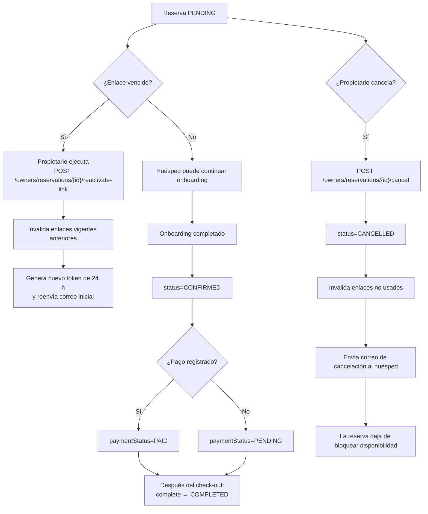

# HostFlow — Flujo actual de reservas

> **Base de análisis:** `backend.zip` proporcionado para esta revisión, contrastado con `hostflow-contrato-y-plan-reestructuracion-reservas.md` y los requisitos del proyecto.  
> **Alcance:** flujo de reserva desde la creación por el propietario hasta el cierre operativo (`COMPLETED`), incluyendo pago manual, cancelación y renovación del enlace.  
> **Importante:** el diagrama representa lo que se observa en el backend entregado, no el flujo ideal del plan. Los puntos divergentes están marcados en el inventario.

## 1. Diagrama principal — camino exitoso

```mermaid
flowchart TD
    A["Propietario autenticado"] --> B["POST /owners/reservations"]
    B --> C["ReservationService.createReservation"]
    C --> D["Bloquea/obtiene alojamiento del owner"]
    D --> E["Valida perfil, métodos de pago del alojamiento,<br/>fechas, capacidad y disponibilidad"]
    E -->|Inválido| ERR["Error: no se crea reserva"]
    E -->|Válido| F["Crea Reservation<br/>status=PENDING<br/>paymentStatus=PENDING<br/>snapshot de precio base"]
    F --> G["Crea ReservationLink<br/>token UUID, vence en 24 h"]
    G --> H["Envía correo inicial al huésped<br/>enlace + identidad visual + importe"]
    H --> I["Devuelve ReservationResponse al dashboard"]

    I --> J["Huésped abre URL del frontend con token"]
    J --> K["GET /public/reservations/confirm?token=..."]
    K --> L["getOnboardingDetails(token)<br/>valida token, vigencia y estado"]
    L -->|Inválido / vencido / usado / reserva no PENDING| ERR2["Acceso rechazado"]
    L -->|Válido| M["Devuelve datos públicos del alojamiento,<br/>reserva, métodos de pago del alojamiento,<br/>servicios activos y equivalencias si aplican"]
    M --> N["Huésped completa formulario"]
    N --> O["POST /public/reservations/confirm<br/>CompleteReservationOnboardingRequest"]
    O --> P["Bloquea ReservationLink para evitar doble envío"]
    P --> Q["Valida token y resuelve/crea Guest"]
    Q --> R["Guarda ReservationGuestInfo:<br/>documento, alergias y preferencias"]
    R --> S["Valida servicios seleccionados<br/>y calcula importes en backend"]
    S --> T["Guarda ReservationAdditionalService<br/>con snapshots de precio/cantidad"]
    T --> U["Guarda boatTransferRequested<br/>(solo indicador, no itinerario)"]
    U --> V["Marca link usado"]
    V --> W["Reservation.status=CONFIRMED<br/>paymentStatus sigue PENDING"]
    W --> X["Devuelve resumen final +<br/>métodos de pago del alojamiento"]
    X --> Y["Huésped paga fuera de HostFlow<br/>y envía comprobante por canal externo"]
    Y --> Z["Propietario verifica y ejecuta<br/>POST /owners/reservations/{id}/mark-paid"]
    Z --> AA["paymentStatus=PAID<br/>paidAt + paymentMarkedBy"]
    AA --> AB["Después del commit:<br/>correo de pago confirmado al huésped<br/>y notificación al propietario"]
    AB --> AC["Tras check-out, propietario ejecuta<br/>POST /owners/reservations/{id}/complete"]
    AC --> AD["Reservation.status=COMPLETED"]
```

## 2. Ramas operativas

## 3. Estados actuales observados

| Concepto | Estados / comportamiento |
|---|---|
| Reserva | `PENDING` al crear; `CONFIRMED` al completar onboarding; `CANCELLED` al cancelar; `COMPLETED` al cerrar después del check-out. |
| Pago | `PENDING` al crear y después del onboarding; `PAID` solo por acción manual del propietario. |
| Enlace | token UUID; fecha de expiración; marca de uso; invalidación; histórico de enlaces al renovar. |
| Disponibilidad | `Reservation.isActive()` considera bloqueantes `PENDING` y `CONFIRMED`; canceladas y completadas no bloquean. |

## 4. Alcance y límites importantes

- Los métodos de pago que se presentan al huésped son los del **alojamiento**, no los del huésped.
- HostFlow no procesa ni captura pagos. El propietario registra manualmente que recibió el dinero.
- El onboarding conserva datos personales, alergias, preferencias y servicios adicionales.
- Los detalles de itinerario de lancha no se persisten; el backend recibido conserva el indicador `boatTransferRequested`.
- Los precios adicionales se calculan en backend y se guardan como snapshots asociados a la reserva.
- El backend tiene una operación de cancelación que envía un correo adicional al huésped. Esto debe contrastarse con la decisión de producto de mantener solo los dos correos transaccionales principales; queda señalado en el inventario, no se elimina en esta etapa.
- La operación de disponibilidad existe como endpoint independiente. Su aislamiento por alojamiento debe revisarse antes de considerarla segura para cualquier consumidor.
